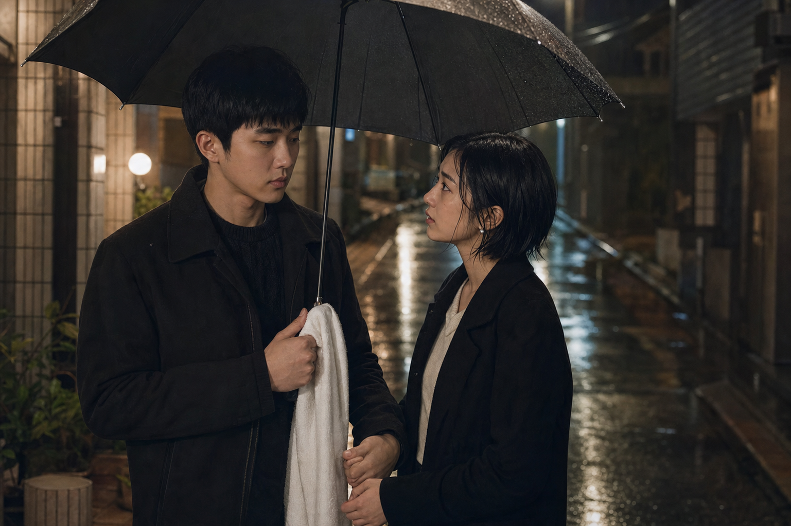

# 136. 그 사람 여자야?

서윤의 질문은 방 안에 오래 남았다. 히터 소리마저 그 말을 지우지 못했고, 창밖 도쿄의 야경도 그 침묵을 덮지 못했다.

그 사람 여자야?

용식은 바로 아니라고 말할 수 없었다. 아니라고 하면 유즈키가 지워지고, 그렇다고 말하면 서윤이 더 선명하게 다칠 걸 알았다. 그는 캐리어 손잡이를 붙잡은 채 서 있었다.

한서윤 "대답이 늦네."

김용식 "전에 일본에서 알게 된 사람이에요."

한서윤 "여자냐고 물었어."

김용식 "네."

서윤은 웃었다. 이번에는 정말 웃음이 아니라, 숨이 빠져나가는 소리였다.

한서윤 "그럼 그렇지. 어쩐지."

김용식 "서윤 씨가 생각하는 그런..."

한서윤 "내가 뭘 생각하는데?"

말이 날카롭게 잘렸다. 용식은 입을 다물었다. 서윤은 코트를 벗어 의자에 걸었다. 손동작이 너무 차분해서 오히려 불안했다. 그녀는 침대 끝에 앉지 않고 창가 의자에 앉았다. 두 사람 사이에 테이블이 놓였다.

한서윤 "초연 씨한테는 나를 숨기고, 나한테는 나고야 여자를 숨기고."

김용식 "숨기려고 한 건..."

한서윤 "말 안 한 것도 숨긴 거야."

그 말에는 반박할 수 없었다. 서윤은 화를 내는 대신 정확하게 짚었고, 그 정확함이 화보다 더 아팠다.

서윤은 테이블 위의 호텔 메모지를 한 장 뽑았다. 거기에 볼펜으로 날짜를 적었다. 12월 10일, 11일, 12일, 13일. 그리고 24일쯤에 동그라미를 쳤다.

한서윤 "나는 여기까지네."

김용식 "그렇게 선 긋지 마요."

한서윤 "선은 내가 긋는 게 아니잖아. 항공권이 긋고, 호텔 예약이 긋고, 네 마음이 긋지."

네 마음.

그 말은 질문이 아니라 확인이었다. 이미 답을 알고 있는 사람의 말투였다. 용식은 거기에 아무 대꾸도 하지 못했다.

다음 날 오전, 두 사람은 말없이 어학원 근처를 걸었다. 용식은 학교 프로그램의 오전 수업에 참석해야 했고, 서윤은 근처 서점에서 기다리겠다고 했다. 헤어지는 골목 앞에서 서윤이 먼저 말했다.

한서윤 "오늘은 안 기다릴래."

김용식 "그럼요?"

한서윤 "혼자 다닐 거야. 나도 도쿄 처음 아니야."

김용식 "그래도 연락은..."

한서윤 "걱정돼?"

김용식 "네."

한서윤 "그럼 좋아해야 하나."

서윤은 그렇게 말하고 먼저 돌아섰다.

수업 내내 용식은 칠판의 한자를 제대로 보지 못했다. 강사의 목소리는 귀에 들어오지 않았고, 폴더폰만 자꾸 만졌다. 초연에게는 수업 중이라고 답했고, 유즈키에게는 아직 나고야 날짜를 확정하지 못했다. 세 사람 모두에게 조금씩 늦고 있었다.

점심시간이 되자 서윤에게 문자가 왔다.

[학원자료] 우에노에 있어. 오고 싶으면 와.

오고 싶으면.

그 말은 기다린다는 말보다 더 서윤다웠다.

용식은 곧장 전철을 탔다. 우에노역 앞은 사람들로 복잡했고, 겨울 햇빛은 빌딩 사이에서 짧게 끊겼다. 서윤은 공원 입구 벤치에 앉아 있었다. 옆에는 작은 종이봉투가 하나 있었다.

김용식 "뭐 샀어요?"

한서윤 "머리핀."

김용식 "보여 줘요."

서윤은 종이봉투에서 작은 검은 머리핀을 꺼냈다.

한서윤 "내 돈으로 샀어."

그 말에 용식은 웃을 수 없었다.

한서윤 "나도 내가 살 수 있는 게 있어."

김용식 "그런 뜻으로 산 거 아니에요. 내가 사 준 것들."

한서윤 "알아. 그래서 더 복잡해."

그녀는 머리핀을 단발 한쪽에 꽂았다. 작은 변화였는데 얼굴이 달라 보였다. 용식은 그걸 보고 있다가, 서윤이 눈을 들자 늦게 시선을 돌렸다.

한서윤 "예뻐?"

김용식 "예뻐요."

용식은 그 대답을 하면서도, 자신이 이미 몇 번이나 같은 말을 다른 얼굴 앞에서 했었는지 떠올렸다. 말은 같았지만, 매번 진심이었다는 게 더 문제였다.

한서윤 "그 사람보다?"

질문은 조용했지만, 도망칠 곳이 없었다.

김용식 "비교할 일이 아니에요."

한서윤 "제일 나쁜 대답이네."

서윤은 일어났다. 용식은 손을 잡으려 했지만, 그녀는 한 번 피했다. 그러다 몇 걸음 뒤에 다시 손을 내밀었다. 피했다가 다시 내미는 손. 그 손 하나에 서윤의 마음이 다 있었다.

저녁에는 비가 조금 내렸다. 두 사람은 우산 하나를 같이 썼다. 우산 안은 좁았고, 어깨가 계속 닿았다. 호텔로 돌아오는 길, 서윤은 먼저 말하지 않았다. 방 안에 들어와서야 젖은 코트를 벗으며 물었다.

한서윤 "나 막을 권리 없지?"

김용식 "무슨..."

한서윤 "나고야 가는 거."

용식은 수건을 건네며 말했다.

김용식 "서윤 씨 일정 끝나고 가는 거예요."

한서윤 "그러니까. 내 일정 끝나면, 나는 끝나는 거잖아."

용식은 젖은 머리끝에서 떨어지는 물방울을 봤다. 서윤은 수건을 받지 않았다. 대신 한 걸음 가까이 왔다.

한서윤 "오늘은 대답하지 마."

김용식 "서윤 씨."

한서윤 "나도 알아. 내가 뭘 듣고 싶은지 모르겠어."

그녀는 이번에는 먼저 손을 잡았다. 젖은 손이 차가웠다. 용식은 수건으로 그 손을 감쌌다.

한서윤 "그냥 오늘은 나만 봐."

용식은 아주 천천히 고개를 끄덕였다.

젖은 머리카락 끝에서 물방울이 그녀의 목덜미를 타고 흘렀다. 용식은 그 물기를 손끝으로 닦아 냈고, 서윤은 그 손을 피하지 않았다. 오히려 눈을 감고 그 감각에 잠깐 기댔다. 빗소리가 창밖에서 낮게 이어지는 동안, 두 사람의 숨소리는 점점 그 소리와 구분되지 않을 만큼 가까워졌다.

한서윤 "오늘 하루만 나쁜 여자 할게."

김용식 "서윤 씨는 나쁜 사람 아니에요."

한서윤 "아니야. 오늘은 나도 알면서 이러는 거니까."

그 말을 끝으로 그녀는 더 말하지 않았다. 대신 젖은 코트를 벗어 던지듯 의자에 걸고, 그의 목덜미에 손을 얹었다. 차가웠던 손끝이 그의 체온에 서서히 데워지는 게 느껴졌다.

창밖 빗소리가 작게 이어졌다. 방 안 조명은 낮았고, 테이블 위 폴더폰은 뒤집힌 채였다. 서윤은 대답을 듣지 않은 밤을 선택했다.

아침에 눈을 떴을 때, 서윤은 먼저 일어나 있었다.

테이블 위에는 귀국 항공권 출력물이 반듯하게 펼쳐져 있었다.
