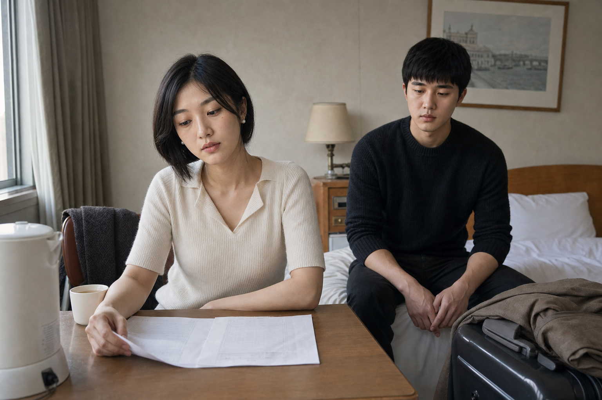

# 137. 귀국 항공권

12월 16일 아침.

귀국 항공권 출력물 위에는 서윤의 이름이 또렷하게 찍혀 있었다. 인천행, 12월 24일. 용식이 예약한 날짜였다. 서윤은 그것을 손가락으로 눌러 펴고 있었다. 종이가 밤새 가방 안에서 구겨졌는지 모서리가 조금 말려 있었다.

김용식 "왜 꺼냈어요?"

한서윤 "확인하려고요."

김용식 "뭘요?"

한서윤 "내가 언제 끝나는지."

끝난다는 말을 그렇게 평범한 목소리로 하자, 용식은 더 아팠다. 그는 침대에서 일어나 앉았다. 방 안에는 전기포트에서 끓인 물 냄새와 어제 비에 젖은 코트의 습기가 섞여 있었다.

김용식 "끝나는 거 아니에요."

한서윤 "그럼 뭐예요?"

김용식 "한국 가도..."

한서윤 "또 연락해요? 또 필요할 때 불러요? 또 숨겨요?"

말은 쏟아지지 않았다. 서윤은 한 문장씩 낮게 놓았다. 그게 더 정확했다.

용식은 테이블 앞으로 갔다. 항공권을 접으려 하자 서윤이 손으로 막았다.

한서윤 "그냥 둬요. 봐야 하니까."

김용식 "뭘 자꾸 확인해요."

한서윤 "초연 씨만 확인하는 사람 아니에요."

그 말은 가볍게 지나갈 수 없었다. 초연은 불안해서 방 사진을 요구했고, 서윤은 상처받지 않기 위해 자기 끝 날짜를 확인하고 있었다. 둘 다 용식이 만든 사람들이었다.

그날은 일부러 멀리 가지 않았다. 두 사람은 호텔 근처 골목의 작은 카페에서 아침을 먹고, 신주쿠 지하상가를 천천히 걸었다. 서윤은 새 머리핀을 꽂고 있었다. 용식은 그것을 볼 때마다 전날 우에노 벤치가 떠올랐다.

점심 무렵, 초연에게서 문자가 왔다.

[김초연] 오늘 사진은?

용식은 지하상가 벽에 붙은 크리스마스 장식을 배경으로 사진을 찍었다. 사람들 사이에서 서윤이 프레임에 들어올까 봐 각도를 세 번 바꿨다. 서윤은 조금 떨어져 그 모습을 봤다.

한서윤 "이제 잘 찍네요."

김용식 "서윤 씨."

한서윤 "비꼬는 거 맞아요."

용식은 사진을 보내고 폴더폰을 닫았다. 서윤은 손에 든 커피를 한 모금 마셨다.

한서윤 "오늘은 어디 데려갈 거예요?"

김용식 "가고 싶은 데 있어요?"

한서윤 "네."

그녀가 고른 곳은 도쿄 타워가 보이는 언덕길이었다. 전철을 갈아타고 걸어 올라가는 동안, 서윤은 거의 말하지 않았다. 대신 사진을 몇 장 찍었다. 용식의 얼굴이 아니라, 길모퉁이의 자판기, 젖은 낙엽, 멀리 보이는 빨간 철탑 같은 것들.

김용식 "왜 그런 것만 찍어요?"

한서윤 "나중에 보면 기억나니까요."

김용식 "내 사진은요?"

한서윤은 폴더폰을 내렸다.

한서윤 "네 사진은 위험하잖아요."

그 말에 용식은 웃지 못했다. 서윤도 웃지 않았다.

저녁에는 작은 이자카야에 들어갔다. 술은 조금만 마셨다. 서윤은 취하지 않았다. 얼굴이 살짝 붉어졌지만, 말은 오히려 또렷했다.

한서윤 "나 오늘은 물어볼래요."

김용식 "뭘요?"

한서윤 "나고야 그 사람하고, 여름에 뭐였어요?"

용식의 젓가락이 멈췄다.

한서윤 "대답하기 싫으면 안 해도 돼요. 근데 나는 대답 안 해도 알아들을 거예요."

김용식 "좋아했어요."

서윤은 눈을 감았다가 떴다.

한서윤 "지금도?"

용식은 이번에도 늦었다.

한서윤 "됐어요."

김용식 "서윤 씨."

한서윤 "늦는 대답도 대답이에요."

이자카야 밖으로 나오자 밤공기가 차가웠다. 서윤은 술기운 때문인지 조금 비틀거렸지만, 판단을 잃을 정도는 아니었다. 용식이 팔을 잡자 그녀는 밀어내지 않았다.

한서윤 "나 오늘 좀 못됐죠."

김용식 "아니요."

한서윤 "못된 거 맞아요. 알면서 물었으니까."

호텔 방에 돌아온 뒤, 서윤은 테이블 위 귀국 항공권을 다시 접어 지갑에 넣었다. 그리고 용식 앞에 섰다.

한서윤 "오늘은 내가 알고도 있는 거예요."

김용식 "무슨 뜻이에요?"

한서윤 "네가 누구 생각하는지 다 모르는 척은 안 하겠다고요."

그녀는 손을 올려 용식의 목도리를 풀었다. 초연이 준 목도리였다. 손끝이 잠깐 멈췄다. 서윤은 그것을 알아봤는지, 아니면 그냥 감으로 느꼈는지 묻지 않았다.

한서윤 "이거 오늘은 벗어요."

용식은 목도리를 받아 의자에 올려놓았다.

서윤은 한 걸음 더 가까워졌다.

한서윤 "괜찮냐고 물어볼 거면, 제대로 물어봐요."

김용식 "괜찮아요?"

한서윤은 대답을 오래 미루지 않았다.

한서윤 "응."

이번에는 반말이었다.

방 안의 불이 꺼진 뒤에도 창밖 도쿄 타워의 붉은 빛은 희미하게 남아 있었다.

아침, 의자 위 초연의 목도리는 그대로 접혀 있었다.

서윤은 그것을 보지 않는 척했다.
