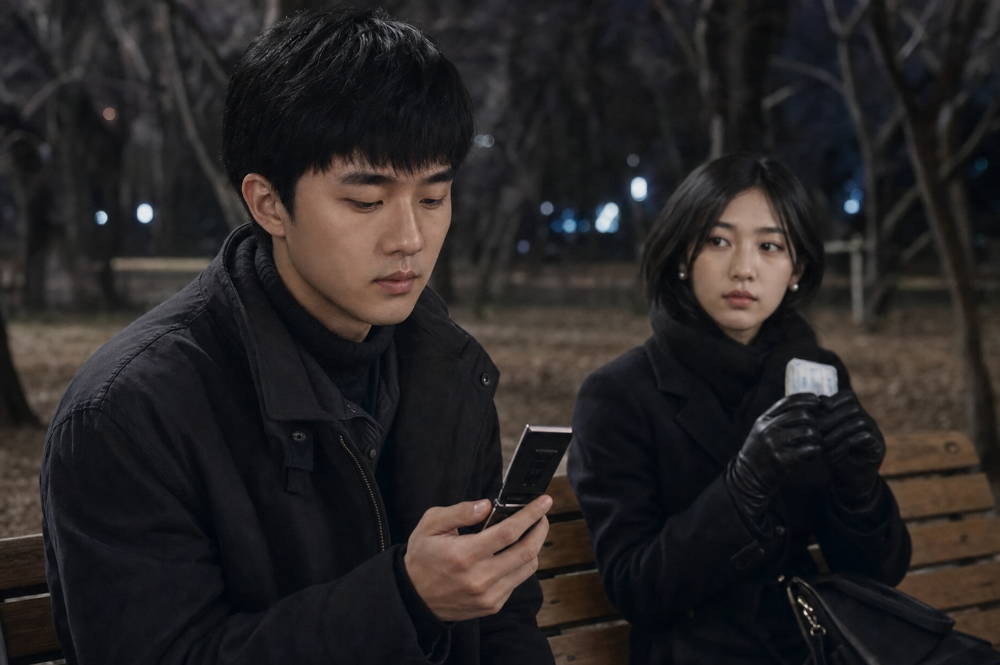

# 138. 둘만 아는 도쿄

12월 18일.

며칠 사이 도쿄는 두 사람에게 조금 익숙해졌다. 낯설던 골목도, 낯설던 침묵도 이제는 그러려니 하는 것들이 되어 있었다. 호텔 앞 편의점 직원은 용식이 들어가면 바로 봉투를 꺼냈고, 서윤은 말하지 않아도 창가 쪽 자리의 카페를 골랐다. 우에노역에서 어느 출구로 나가야 덜 헤매는지도 알게 됐다.

익숙함은 생각보다 빨리 왔고, 그만큼 위험했다.

마치 정말 둘만의 생활이 생긴 것처럼 보였기 때문이다. 용식은 가끔 그 생활이 진짜였으면 좋겠다고 생각하다가, 그 생각을 하고 있다는 사실 자체에 놀랐다. 초연도, 유즈키도 없는 세상에서 서윤과 단둘이 사는 며칠. 그런 상상은 하루짜리로도 위험했다.

오전 수업이 끝나고 용식은 신주쿠역 동쪽 출구에서 서윤을 만났다. 서윤은 검은 코트에 전날 산 가죽 장갑을 끼고 있었다. 머리핀은 하지 않았다. 대신 진주귀걸이는 그대로였다.

한서윤 "오늘은 늦었네."

김용식 "수업이 좀 길어졌어요."

한서윤 "초연 씨한테도 그렇게 말했어?"

김용식 "응."

서윤은 짧게 고개를 끄덕였다. 예전 같았으면 그 말끝을 물고 늘어졌을 텐데, 오늘은 그러지 않았다. 며칠 사이 그녀도 배웠다. 모든 거짓말을 그 자리에서 확인하면, 남는 건 피곤함뿐이라는 것을.

두 사람은 오모이데요코초 골목을 지나 작은 라멘집에 들어갔다. 좁은 카운터에 나란히 앉자 어깨가 닿았다. 김이 오른 국물 냄새가 얼굴 가까이 올라왔다. 서윤은 뜨거운 면을 불다가, 용식 쪽으로 고개를 기울였다.

한서윤 "이런 데는 혼자 왔어? 여름에."

김용식 "몇 번."

한서윤 "그 사람이랑?"

용식은 젓가락을 멈추지 않으려 했지만, 손이 조금 굳었다. 서윤은 그 작은 반응을 보고도 더 묻지 않았다.

한서윤 "알겠어."

오히려 그 한마디가 더 무거웠다.

오후에는 우에노 공원을 걸었다. 겨울나무들은 잎이 거의 없었고, 길가에는 낙엽이 마른 종이처럼 모여 있었다. 서윤은 작은 박물관 앞에서 사진을 찍어 달라고 했다. 용식은 그녀를 프레임에 담았다. 검은 코트, 창백한 겨울빛, 웃음을 완전히 짓지 못한 얼굴.

찰칵.

서윤은 사진을 확인하고 말했다.

한서윤 "나 되게 애매하게 웃네."

김용식 "예뻐요."

한서윤 "그 말은 이제 좀 늦게 해도 돼."

김용식 "왜요?"

한서윤 "너무 빨리 하면 돈처럼 들려."

용식은 입을 다물었다.

저녁이 되자 유즈키에게서 메일이 왔다. 제목은 짧았다.

나고야, 눈 올지도 몰라.

용식은 공원 벤치에 앉은 채 화면을 열지 못했다. 서윤은 옆에서 손난로를 만지작거리다가 말했다.

한서윤 "그 사람이야?"

김용식 "메일이에요."

한서윤 "읽어."

김용식 "나중에."

한서윤 "나 때문에 안 읽는 척하지 마. 그런 척이 더 싫어."

용식은 메일을 열었다.

[나카타 유즈키] 오늘 아침에 어머니가 가게 앞 물통이 얼었다고 했어요. 나고야는 도쿄보다 조용해요. 네가 오면, 여름에 못 보여 준 곳부터 보여 주고 싶어요.

문장 끝에 작은 웃는 얼굴이 있었다. 유즈키답게 솔직하고 따뜻했다. 용식은 화면을 오래 봤다.

서윤은 그 얼굴을 봤다.

한서윤 "좋아하네."

김용식 "서윤 씨."

한서윤 "그 표정은 나한테 한 적 없어."

용식은 아무 말도 하지 못했다. 서윤은 자리에서 일어났다. 벤치 위 손난로가 식어 가고 있었다.

그날 밤, 두 사람은 호텔로 바로 돌아가지 않았다. 신주쿠의 작은 이자카야에 들어가 따뜻한 사케를 한 잔씩만 마셨다. 서윤은 취하지 않았다. 대신 말이 더 조용해졌다.

한서윤 "내가 한국 가면, 초연 씨한테는 뭐라고 할 거야?"

김용식 "그냥 일정대로 있다고."

한서윤 "그럼 나고야 가서도 방 사진 보내?"

김용식 "아마."

한서윤 "유즈키 씨한테는 뭐라고 할 건데?"

이름이 나오는 순간, 용식은 고개를 들었다.

김용식 "이름은 어떻게..."

한서윤 "메일 화면에 있었어. 일본 이름이라 눈에 들어오던데."

용식은 자신이 화면을 너무 오래 열어 두었다는 걸 뒤늦게 알았다.

서윤은 잔을 내려놓았다.

한서윤 "나 이런 거 잘 봐. 초연 씨도 잘 보고. 다은 씨도 아마 잘 보겠지."

정다은 이름까지 나오자, 용식은 눈을 피했다. 이 좁은 방 안에서조차 완전히 숨을 곳이 없다는 사실이 새삼스러웠다.

한서윤 "맞네."

김용식 "그건..."

한서윤 "됐어. 오늘은 거기까지만."

호텔로 돌아오는 택시 안에서 서윤은 용식의 어깨에 머리를 기대지 않았다. 하지만 손은 놓지 않았다. 그 모순이 오히려 지금 관계의 모양 같았다.

방에 들어오자 서윤은 먼저 코트를 벗고, 테이블 위에 손난로를 올려놓았다.

한서윤 "오늘은 내가 묻지 않을게."

김용식 "미안해요."

한서윤 "사과도 하지 마. 사과 들으면 내가 너무 불쌍해져."

그녀는 창가로 갔다. 커튼을 조금 열자 도쿄의 밤빛이 들어왔다. 용식은 뒤에서 그녀의 어깨를 감싸 안았다. 서윤은 처음에는 굳었다가, 천천히 그 손 위에 자기 손을 올렸다.

한서윤 "나도 알고 있어. 이 보름이 끝나면, 내가 질 거라는 거."

김용식 "그런 거 아니에요."

한서윤 "그런 거 맞아. 그래도 오늘은 여기 있잖아."

그녀는 뒤돌아섰다.

한서윤 "그러니까 오늘은 나한테 져."

용식은 그녀의 어깨를 다시 감쌌다. 이번에는 서윤이 먼저 몸을 돌려 그를 마주 봤다. 창밖 도쿄의 불빛이 그녀의 눈동자 안에서 작게 부서졌다. 서윤은 손을 뻗어 그의 코트 깃을 천천히 벗겨 냈다. 손끝이 어깨선을 따라 내려갈 때마다 낮은 숨이 새어 나왔다.

한서윤 "오늘은 아무것도 묻지 마. 나도 안 물을 테니까."

김용식 "응."

그 짧은 대답 하나로 방 안의 모든 질문이 잠시 미뤄졌다. 서윤의 입술이 그의 입술에 닿았고, 두 번째부터는 서로가 서로를 놓지 않았다. 손난로 두 개가 테이블 위에서 나란히 식어 가는 동안, 창밖 불빛만이 커튼 틈으로 조금씩 옅어졌다.

방 안의 커튼이 완전히 닫혔다.

다음 아침, 창가에는 손난로 두 개가 나란히 식어 있었다.
