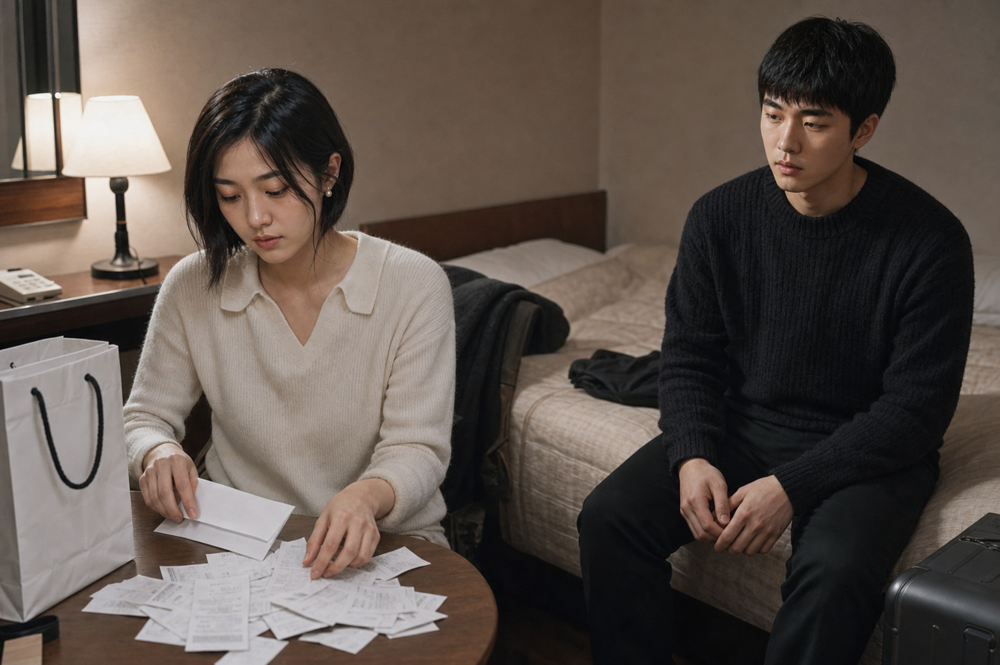

# 139. 서윤의 계산

12월 21일 밤.

서윤은 호텔 테이블 위에 영수증을 펼쳐 놓았다.

코트, 니트, 장갑, 구두, 저녁 식사, 택시, 작은 부적, 라멘집 계산서, 편의점 영수증. 대부분은 용식이 무심하게 접어 둔 것들이었다. 서윤은 그것들을 날짜순으로 나누다가, 어느 순간 손을 멈췄다.

김용식 "왜 그래요?"

한서윤 "세어 보니까 이상해서요."

김용식 "뭐가요?"

한서윤 "많이 받았는데, 받은 사람이 된 느낌만 남아요."

용식은 침대 끝에 앉아 있었다. 그는 뭐라고 말해야 할지 몰랐다. 돈은 분명히 그가 가진 힘이었다. 또래가 쉽게 할 수 없는 걸 하게 해 주고, 관계의 속도를 바꾸고, 누군가의 하루를 특별하게 만들어 줬다. 그런데 돈으로 만든 특별함은 가끔 사람을 더 외롭게 만들었다.

서윤은 영수증 하나를 들어 올렸다.

한서윤 "이건 긴자 코트."

다른 하나.

한서윤 "이건 우에노에서 먹은 거."

또 하나.

한서윤 "이건 호텔 앞 편의점."

그녀는 영수증을 다시 내려놓았다.

한서윤 "근데 내가 네 여자라는 영수증은 없네요."

김용식 "그렇게 말하지 마요."

한서윤 "말이 좀 싸요?"

김용식 "아니요."

한서윤 "그럼 정확하네요."

용식은 테이블 앞으로 다가갔다. 영수증들을 쓸어 모으려 하자, 서윤이 손목을 잡았다.

한서윤 "버리지 마요."

김용식 "왜요?"

한서윤 "남겨 둘 거예요."

김용식 "그런 건..."

한서윤 "초연 씨한테 보여 주려고 남기는 거 아니에요."

서윤은 용식의 말을 끊었다. 그리고 조금 웃었다.

한서윤 "아직은."

아직은.

그 말이 방 안의 공기를 바꿨다.

용식은 손을 거두었다. 서윤은 영수증을 작은 봉투에 넣었다. 봉투는 호텔 책상 서랍에 있던 흰색 메모 봉투였다. 겉에는 아무것도 쓰지 않았다.

그날 낮, 두 사람은 요코하마까지 다녀왔다. 바닷바람은 생각보다 차가웠고, 서윤은 새 코트를 입었다. 빨간 벽돌 창고 앞에서 그녀는 사진을 찍어 달라고 했고, 용식은 이번에는 그녀를 정면으로 담았다.

서윤은 사진을 확인하고 한참 동안 말이 없었다.

한서윤 "나 이 사진 갖고 있을래요."

김용식 "줄게요."

한서윤 "네가 찍은 내 사진. 위험한 거잖아요."

김용식 "그래도 갖고 싶으면."

서윤은 폴더폰을 닫았다.

한서윤 "응. 갖고 싶어요."

그 말은 사진 얘기였지만, 사진만은 아니었다.

밤이 되어 호텔로 돌아온 뒤, 초연에게서 전화가 왔다. 용식은 화장실로 들어가 받았다. 물소리를 틀어 놓고 통화하는 버릇이 생겼다. 초연은 오늘 누구와 있었는지, 왜 사진 속 배경이 매번 사람이 없는 각도인지, 학교 프로그램 애들 사진은 왜 하나도 없는지 물었다.

김초연 "이상해. 너."

김용식 "사진 찍을 타이밍이 없어서 그래."

김초연 "그럼 내일은 같이 찍은 거 보내."

김용식 "알겠어."

김초연 "여자랑 찍으라는 말 아니야."

용식은 대답을 늦췄다.

김초연 "용식아."

김용식 "응."

김초연 "나 진짜 무서워."

그 말에는 화보다 더 큰 피로가 있었다. 용식은 거울 속 자기 얼굴을 봤다. 물소리가 작게 흔들렸다.

김용식 "미안해. 잘할게."

전화를 끊고 나오자 서윤은 침대 위에 앉아 있었다. 흰 봉투는 이미 그녀 가방 안에 들어가 있었다.

한서윤 "물 틀고 전화하는 거, 초연 씨도 언젠가 알겠네요."

김용식 "들었어요?"

한서윤 "안 들으려고 해도 들려요. 이 방 작잖아요."

서윤은 피곤한 얼굴이었다. 하지만 눈은 또렷했다.

한서윤 "나 한국 가고 나면, 바로 나고야 가요?"

김용식 "하루 정도 정리하고..."

한서윤 "거짓말하지 말고."

용식은 숨을 내쉬었다.

김용식 "아마 바로 갈 것 같아요."

서윤은 고개를 끄덕였다. 놀라지 않았다. 이미 알고 있었던 사람처럼.

한서윤 "그럼 나 공항 데려다주고, 그다음 표 꺼내겠네요."

김용식 "서윤 씨."

한서윤 "상상했는데 너무 잘 보여서 싫다."

그녀는 웃었다가, 금방 웃음을 지웠다.

한서윤 "나 그때 울면, 붙잡을 거예요?"

용식은 대답을 못 했다.

서윤은 그것만으로 충분하다는 듯 눈을 감았다.

한서윤 "역시."

방 안 히터 소리가 낮게 돌았다. 용식은 침대 옆에 앉았다. 서윤은 그의 어깨에 기대지 않았지만, 멀어지지도 않았다.

한서윤 "오늘은 그냥 자요."

김용식 "화났어요?"

한서윤 "아니요. 오늘 가까워지면 내가 더 계산 못 할 것 같아서."

그녀는 이불을 끌어올렸다.

용식은 불을 껐다.

어둠 속에서 봉투가 들어간 서윤의 가방만 유난히 또렷하게 보이는 것 같았다.
