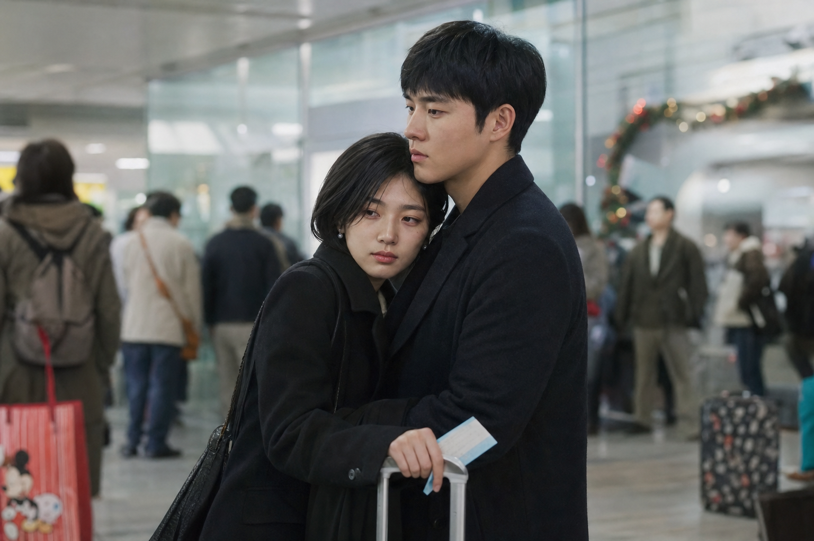

# 140. 돌아가는 사람

12월 24일 아침.

서윤은 짐을 빨리 쌌다. 보름 동안 늘어난 물건들은 생각보다 많았다. 긴자에서 산 코트, 니트, 장갑, 구두, 우에노에서 산 머리핀, 아사쿠사 부적, 요코하마 사진, 호텔 봉투 안 영수증들. 캐리어는 올 때보다 무거워졌고, 서윤은 지퍼를 올리다 한 번 멈췄다.

김용식 "도와줄까요?"

한서윤 "아니요. 내가 닫을게요."

그녀는 두 손으로 캐리어를 눌렀다. 지퍼가 드르륵 소리를 내며 닫혔다. 그 소리가 이상하게 전날 밤보다 더 차갑게 들렸다.

김용식 "공항까지 같이 갈게요."

한서윤 "그건 해 줘야죠."

서윤은 거울 앞에서 머리를 정리했다. 진주귀걸이를 손끝으로 한번 만지고, 작은 머리핀을 꽂았다. 새 코트는 입지 않았다. 대신 한국에서 입고 온 검은 코트를 걸쳤다.

김용식 "새 코트 안 입어요?"

한서윤 "그건 여기 두고 온 기분이라."

김용식 "가져가잖아요."

한서윤 "응. 가져는 가요."

말이 맞물리지 않았다. 용식은 더 묻지 않았다.

나리타로 가는 리무진버스 안에서 두 사람은 나란히 앉았다. 서윤은 창가를 봤고, 용식은 통로 쪽에서 폴더폰을 만졌다. 초연에게는 오늘 학교 프로그램 일정 때문에 연락이 늦을 수 있다고 미리 보내 두었다. 유즈키에게는 아직 나고야 도착 시간을 보내지 못했다.

서윤이 말했다.

한서윤 "보내요."

김용식 "뭘요?"

한서윤 "나고야 간다고."

용식은 폴더폰을 닫았다.

김용식 "공항 도착하고."

한서윤 "내 앞에서는 또 미루네요."

버스 창밖으로 겨울 논과 낮은 건물들이 지나갔다. 서윤은 손을 주머니에 넣은 채 말했다.

한서윤 "나한테는 끝까지 다정하네요."

김용식 "그게 나빠요?"

한서윤 "나쁘진 않아요. 그래서 미워하기가 애매해요."

용식은 그녀의 손을 잡고 싶었지만, 잡지 못했다. 서윤이 손을 주머니에서 꺼내지 않았기 때문이다.

공항은 크리스마스 이브라 더 붐볐다. 가족 단위 여행객, 연인, 유학생, 회사원들이 출국장 앞을 오갔다. 서윤은 체크인을 마치고 탑승권을 받아 들었다. 종이는 작았다. 그 작은 종이 하나가 보름을 끝냈다.

한서윤 "여기까지네요."

김용식 "들어가기 전까지 같이 있을게요."

한서윤 "그 말도 참 잘해요."

두 사람은 출국장 옆 카페에 앉았다. 커피는 뜨거웠고, 컵홀더에는 일본어로 겨울 한정 문구가 적혀 있었다. 서윤은 컵을 두 손으로 감싸고 있었다.

한서윤 "나 한국 가서 뭐라고 해야 할까요?"

김용식 "누구한테요?"

한서윤 "나한테요."

용식은 대답하지 못했다.

한서윤 "좋은 여행이었다고 하면 너무 바보 같고, 나쁜 여행이었다고 하면 거짓말이고."

김용식 "미안해요."

한서윤 "그 말 말고."

용식은 한참 뒤에야 말했다.

김용식 "고마웠어요."

서윤은 컵을 내려놓았다.

한서윤 "그 말도 싫다."

눈물이 바로 떨어지지는 않았다. 서윤은 울음을 참는 데 익숙한 사람처럼 눈을 크게 뜨고 있었다. 용식은 그 얼굴을 보며, 붙잡을 수 없는 이유들을 하나씩 떠올렸다. 초연, 유즈키, 학교, 거짓말, 보름이라는 약속. 그런데 그 모든 이유보다 더 정확한 건 하나였다.

그는 서윤을 붙잡을 만큼 선택하지 않았다.

출국장 앞에서 서윤은 캐리어 손잡이를 잡았다.

한서윤 "안아 줘요."

용식은 그녀를 안았다. 서윤의 코트는 차가웠고, 목덜미에서는 호텔 방에서 익숙해진 향이 났다. 그녀는 그의 등을 세게 잡지 않았다. 오히려 아주 조심스럽게, 기억하려는 사람처럼 손을 올렸다.

한서윤 "나 이번엔 사진 밖에 안 있을래요."

김용식 "서윤 씨."

한서윤 "한국 가면 연락해요. 근데 필요할 때만 하지 말고."

김용식 "할게요."

한서윤 "믿지는 않을게요."

그녀는 물러섰다. 눈가가 붉었지만, 끝내 울지는 않았다.

출국장 안으로 들어가기 전, 서윤은 한 번 돌아봤다. 용식은 손을 흔들었다. 서윤도 아주 작게 손을 들었다. 그리고 곧 사람들 사이로 사라졌다.

용식은 한동안 그 자리에 서 있었다.

폴더폰이 울렸다.

[김초연] 오늘 사진 왜 없어?

그는 답장을 쓰지 못했다.

다른 메일함에는 유즈키의 이름이 있었다.

용식은 가방 안쪽에서 접어 둔 표를 꺼냈다. 도쿄에서 나고야로 가는 신칸센 예약 확인서였다. 출발 시간은 그날 오후였다.

서윤이 사라진 출국장 유리문에 용식의 얼굴이 비쳤다.

그는 그 얼굴을 오래 보지 못했다.
