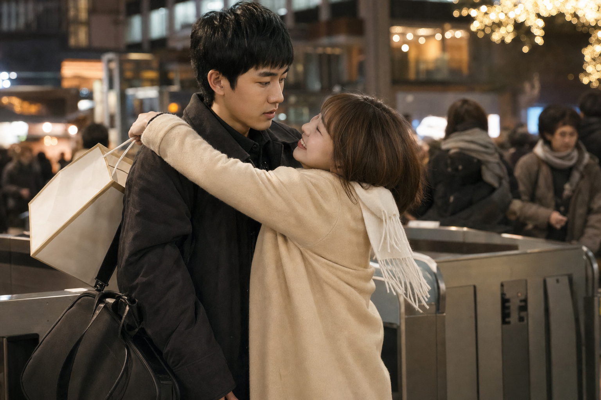

# 141. 나고야의 겨울

신칸센 창밖으로 도쿄의 건물들이 뒤로 밀려났다.

12월 24일 오후. 용식은 창가 자리에 앉아 있었다. 무릎 위에는 작은 가방 하나, 점퍼 안쪽에는 초연이 생일날 준 편지, 가방 바깥 주머니에는 서윤이 공항에서 마지막으로 건넨 작은 손난로가 들어 있었다. 손난로는 이미 식었지만, 버리지 못했다.

도쿄역을 떠난 열차는 속도를 올렸다. 회색 건물들이 낮아지고, 창밖 풍경이 조금씩 넓어졌다. 용식은 폴더폰을 열었다.

[김초연] 오늘 사진 왜 없어?

아직 답하지 못한 문자였다.

그는 짧게 썼다.

[김용식] 이동이 많아서 정신없었어. 밤에 보낼게.

거짓말은 이제 피곤할 만큼 익숙했다.

유즈키에게는 도착 시간을 보냈다.

[김용식] 오늘 저녁 나고야 도착해. 늦어서 미안해.

답장은 얼마 지나지 않아 왔다.

[나카타 유즈키] 정말? 역에서 기다릴게. 추우니까 천천히 와.

정말?

그 한 단어에 여름의 얼굴이 있었다. 나리타 공항에서 울던 유즈키, 하나비 마츠리의 유카타, 오다이바 프리쿠라, 두부조림 냄새, 겨울에 다시 오겠다는 약속. 용식은 화면을 닫았다. 신칸센 창에 비친 자기 얼굴은 며칠 사이 조금 야위어 보였다.

나고야역에 도착했을 때, 밖은 이미 어두웠다.

역 안은 도쿄보다 조용했지만, 크리스마스 이브라 사람들의 걸음은 들떠 있었다. 커플들이 작은 케이크 상자를 들고 지나갔고, 전광판 아래에는 약속 장소를 찾는 사람들이 모여 있었다. 용식은 개찰구를 나오며 주변을 살폈다.

유즈키는 기둥 옆에 서 있었다.

두꺼운 베이지 코트에 하얀 목도리를 두르고, 손에는 작은 종이봉투를 들고 있었다. 여름보다 머리카락이 조금 길어졌고, 얼굴은 더 마른 것 같았다. 하지만 눈이 마주치는 순간, 그녀의 표정은 그대로였다. 숨기지 못하고 먼저 밝아지는 얼굴.

나카타 유즈키 "용식!"

그녀는 거의 뛰어왔다. 용식은 캐리어를 놓고 그녀를 안았다. 유즈키의 몸은 차가운 바깥 공기를 머금고 있었지만, 팔은 망설임 없이 그의 등을 감쌌다.

나카타 유즈키 "진짜 왔어."

김용식 "응. 늦었지."

나카타 유즈키 "늦어도 왔잖아."

그 말이 너무 깨끗해서, 용식은 대답을 잃었다.

유즈키는 물러서서 그의 얼굴을 양손으로 보려다가, 사람 많은 역 안이라는 걸 뒤늦게 의식하고 손을 내렸다. 대신 웃었다.

나카타 유즈키 "추웠지? 배고프지? 아, 한국말... 배고파?"

김용식 "조금."

나카타 유즈키 "조금 아니야. 얼굴이 배고픈 얼굴이야."

그녀의 서툰 한국말은 여름보다 조금 늘어 있었다. 용식은 웃었다. 며칠 만에 처음으로 계산하지 않은 웃음이었다.

역 밖으로 나오자 바람이 강했다. 나고야의 밤은 도쿄보다 더 낮고 넓었다. 유즈키는 용식의 캐리어 손잡이를 잡으려 했고, 용식은 괜찮다고 막았다.

나카타 유즈키 "내가 도와줄게."

김용식 "무거워."

나카타 유즈키 "나 힘 있어."

그녀는 굳이 캐리어 손잡이 한쪽을 잡았다. 둘이 같이 끄는 캐리어는 조금 우스꽝스럽게 비틀거리며 움직였다. 그런데 그 어색함이 좋았다. 누군가를 숨기기 위해 각도를 재는 걸음이 아니라, 같이 가기 위해 속도를 맞추는 걸음이었다.

유즈키가 데려간 곳은 역 근처의 작은 식당이었다. 뜨거운 미소된장국과 생선구이, 밥, 절임 반찬이 나왔다. 용식은 첫 숟가락을 뜨자마자 긴장이 조금 풀리는 걸 느꼈다.

나카타 유즈키 "어머니가 오늘 가게 일 끝나고 케이크 사 오라고 했어."

김용식 "나 때문에?"

나카타 유즈키 "응. 늦은 생일. 그리고 크리스마스."

용식은 숟가락을 내려놓았다.

나카타 유즈키 "왜?"

김용식 "그냥... 고마워서."

나카타 유즈키 "고마우면 많이 먹어."

그녀는 너무 쉽게 말했다. 그래서 더 어렵지 않았다.

식당을 나와 유즈키의 집 쪽으로 가는 전철을 탔다. 그녀는 아버지의 두부 가게가 역에서 조금 걸어야 한다고 설명했다. 가게 위 작은 집, 아침 일찍 끓는 물 냄새, 어머니가 준비해 둔 이불, 남동생이 궁금해한다는 이야기까지 쉬지 않고 말했다.

용식은 그 말을 들으며 창밖을 봤다.

초연에게 보낼 사진은 아직 없었다. 서윤은 지금쯤 비행기 안이거나 인천으로 향하는 길일 것이다. 도쿄 호텔 방의 영수증 봉투, 공항에서 참은 울음, 초연의 방 사진 요구, 전부 아직 사라지지 않았다.

하지만 유즈키는 그것들을 몰랐다.

그녀는 그저 여름 약속을 믿고 기다린 사람처럼, 용식 옆에서 손을 잡았다.

나카타 유즈키 "손 차가워."

김용식 "괜찮아."

나카타 유즈키 "거짓말."

유즈키는 자기 목도리 끝으로 용식의 손등을 감쌌다. 작은 행동이었다. 그런데 용식은 그 순간, 도쿄의 호텔 조명보다 이 전철 안 형광등이 더 오래 남을 것 같다고 생각했다.

밤 늦게 두부 가게 앞에 도착했을 때, 셔터는 이미 내려가 있었다. 안쪽에서는 희미하게 콩 냄새와 따뜻한 물 냄새가 났다. 유즈키는 작은 열쇠로 옆문을 열었다.

나카타 유즈키 "어서 와."

그 말은 일본어였고, 집의 말이었다.

용식은 문턱 앞에서 잠깐 멈췄다.

유즈키가 돌아봤다.

나카타 유즈키 "왜?"

김용식 "아니. 그냥."

그는 신발을 벗었다.

문 안쪽에서 따뜻한 공기가 밀려왔다. 그 순간 폴더폰이 짧게 울렸다. 초연의 이름이었다.

용식은 보지 않았다.

유즈키의 집 안에서는 작은 케이크 상자가 열리고 있었다.
