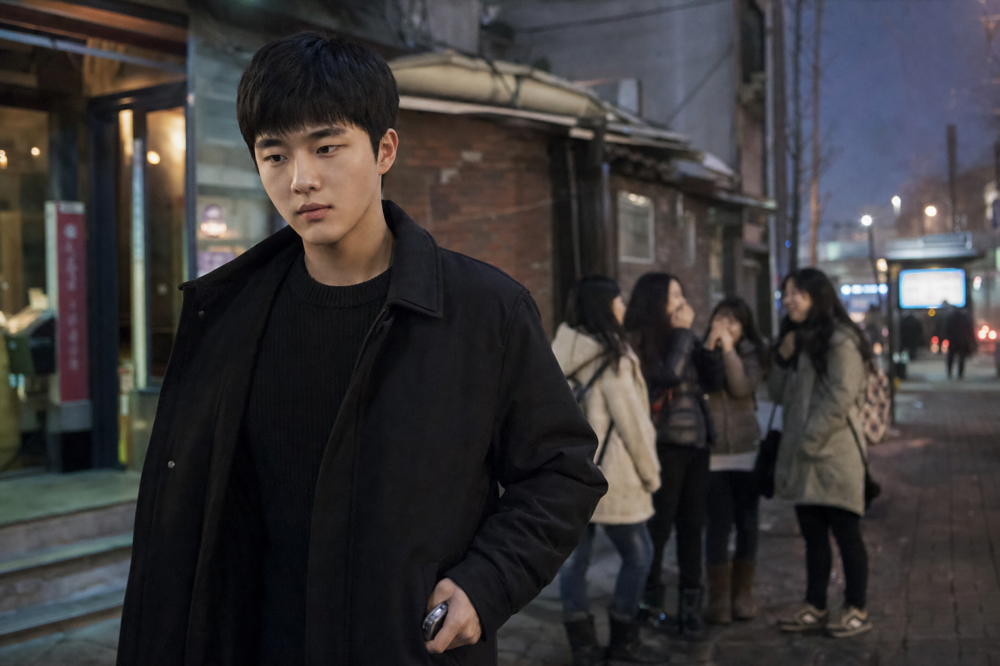

# 152. 얘기 좀 해

초연의 침묵은 사흘째 이어졌다.

1월 18일 아침, 용식은 눈을 뜨자마자 폴더폰을 확인했다. 새 문자는 없었다. 예전 같으면 그 공백에 불안했을 것이다. 지금도 불안은 있었다. 그런데 그 밑에 다른 감정이 깔려 있었다.

안도.

그는 그 단어를 떠올리고 바로 얼굴을 찡그렸다. 초연이 연락하지 않는 게 편하다는 사실을 인정하고 싶지 않았다. 그런데 방 안은 조용했고, 아무도 사진을 요구하지 않았고, 폴더폰 화면은 검은 채로 누워 있었다. 그 조용함은 잘못된 방식으로 달콤했다.

어머니가 방문 밖에서 불렀다.

[김용식 어머니] "밥 먹어라."

용식은 대답하고 일어났다. 거실에는 평범한 아침이 있었다. 밥 냄새, 국 냄새, 텔레비전 소리. 어머니는 반찬을 꺼내며 별생각 없이 물었다.

[김용식 어머니] "일본은 잘 다녀왔고?"

[김용식] "응."

[김용식 어머니] "초연이는 잘 지내니?"

젓가락이 잠깐 멈췄다.

[김용식] "잘 지내겠지."

[김용식 어머니] "왜 남 얘기하듯 해."

용식은 밥을 입에 넣었다. 대답을 미루는 가장 쉬운 방법이었다. 어머니는 더 묻지 않았다. 가족은 아직 아무것도 몰랐다. 그 무지가 부럽기도 하고, 다행이기도 했다.

방으로 돌아오자 서윤에게 문자가 와 있었다.

[한서윤] 어제 답 안 하더라.

용식은 침대에 앉았다. 이번에는 오래 망설이지 않았다.

[김용식] 미안해요.

답장은 금방 왔다.

[한서윤] 초연 씨랑 싸웠어?

용식은 손가락을 멈췄다. 서윤은 늘 한 박자 빠르게 찔렀다. 초연은 증거를 찾아 움직였고, 서윤은 표정 없는 문자만으로 빈틈을 봤다.

[김용식] 그냥 좀.

[한서윤] 그냥 좀, 이 제일 싫어.

용식은 피식 웃었다. 며칠 만에 나온 웃음이었다. 웃을 일이 아닌데 웃음이 났다. 서윤의 말은 날이 있었지만, 그 날은 이상하게 숨구멍 같았다.

[김용식] 볼 수 있어요?

보내고 나서야 심장이 뛰었다. 먼저 보낸 문자였다. 필요해서 보낸 건 맞았다. 그런데 예전처럼 위기를 막기 위한 연락만은 아니었다. 초연의 침묵 속에서 떠오른 사람이 서윤이었다. 그 사실이 분명해졌다.

서윤의 답장은 조금 늦게 왔다.

[한서윤] 지금은 안 돼.

용식은 화면을 보고 가만히 있었다.

곧이어 한 줄이 더 왔다.

[한서윤] 근데 너 먼저 연락한 건 기억해 둘게.

그 문장이 이상하게 오래 남았다. 거절인데, 완전히 거절이 아니었다. 문을 닫으면서 열쇠구멍은 남겨 둔 말.

오후에 용식은 수원역 근처로 나갔다. 딱히 약속이 있는 건 아니었다. 차를 몰고 나와 주차장에 세우고, 역 뒤쪽 골목을 걸었다. 초연과 자주 가던 분식집 앞을 지나는데, 방학이라 그런지 대학생들이 몇 명 모여 있었다. 그중 패션과 쪽으로 보이는 여자애들이 초연 이야기를 했다.

"초연이 요즘 남자들이 많이 말 걸던데."

"걔 예쁘잖아. 근데 남친 있지 않아?"

"있어도 요즘 잘 안 보인다며."

용식은 걸음을 멈추지 않았다. 모르는 척 지나갔다. 그런데 그 말들은 등 뒤에 붙었다. 초연이 예쁜 건 당연했다. 그래서 처음부터 불안했고, 그래서 붙잡고 싶었고, 그래서 다른 남자들의 시선을 싫어했다. 그런데 지금 자신은 초연의 외로움을 방치하고 있었다.

그 사실을 알면서도, 그는 바로 전화를 걸지 않았다.

저녁 무렵 초연에게서 드디어 문자가 왔다.

[김초연] 이번 주말에 얘기 좀 해.

문장은 짧았다.

용식은 화면을 보고 한동안 움직이지 않았다. 올 것이 왔다. 그런데 이상하게, 겁보다 피곤이 먼저 왔다. 무슨 말을 해야 할지 생각하기 전에, 어떻게 미룰 수 있을지가 떠올랐다.

그는 답장을 썼다.

[김용식] 이번 주말은 집안 일 때문에 좀.

지웠다.

[김용식] 알겠어.

그것도 지웠다.

폴더폰 화면 위에 커서가 깜빡였다. 초연은 기다리고 있을 것이다. 화가 났을 수도 있고, 울고 있을 수도 있고, 정말 끝을 말하려고 할 수도 있었다. 예전의 용식이라면 그 모든 가능성에 바로 달려갔을 것이다. 지금의 그는 침대 끝에 앉아, 며칠만 더 미루면 숨을 쉴 수 있을 것 같다는 생각을 했다.

어차피 며칠인데.

그 생각이 떠오른 순간, 그는 자기 자신이 조금 낯설어졌다.

폴더폰이 다시 울렸다.

[한서윤] 내일 밤은 돼.

초연의 문자가 열린 화면 위로, 서윤의 알림이 겹쳤다. 용식은 두 이름을 번갈아 봤다. 하나는 대화를 요구했고, 하나는 시간을 내주겠다고 했다.

그는 먼저 서윤의 문자를 열었다.

[김용식] 갈게요.

전송을 누른 뒤에야, 초연의 문자가 아직 답을 기다리고 있다는 걸 다시 봤다. 용식은 한참 뒤에야 짧게 보냈다.

[김용식] 이번 주말 전에 얘기하자. 조금만 시간 줘.

초연의 답장은 밤늦게 왔다.

[김초연] 그래. 근데 진짜 얘기해야 돼.

그 문장에는 매달림도, 화도, 지침도 섞여 있었다. 용식은 답장을 하지 않았다.

폴더폰을 닫은 뒤에도, 서윤에게 보낸 "갈게요"라는 세 글자만 손끝에 남아 있었다.
