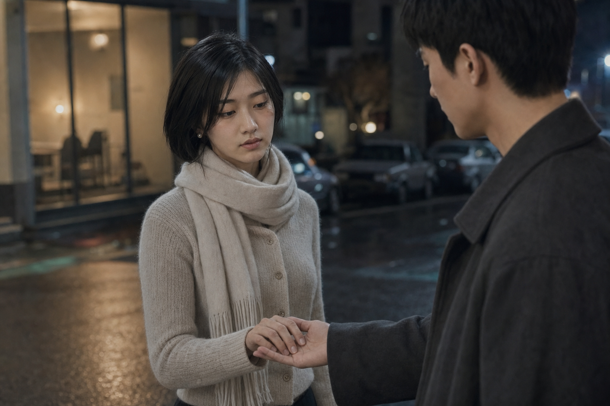

# 156. 내가 부르기 전에

설 연휴가 끝나자 거리는 다시 평일의 얼굴로 돌아왔다.

1월 27일 저녁, 수원역 앞에는 명절 선물 포장지가 구겨진 채 쓰레기통 옆에 쌓여 있었다. 며칠 전까지 들떠 있던 가게들은 다시 가격표와 할인 문구를 앞세웠고, 버스정류장 사람들은 각자 목도리에 턱을 묻고 서 있었다. 용식은 차를 세워 두고 카페 앞에서 서윤을 기다렸다.

먼저 연락하겠다는 약속을 지키려고 했다. 그게 대단한 일은 아니었다. 문자 하나 보내는 것. 그런데 초연에게는 그 문자 하나가 그렇게 어려웠고, 서윤에게는 하루 종일 타이밍을 보고 있었다.

그는 오후 세 시쯤 문자를 보냈다.

[김용식] 오늘 저녁에 볼 수 있어요?

서윤의 답은 한 시간 뒤에 왔다.

[한서윤] 내가 부르기 전에 연락했네요.

[김용식] 네.

[한서윤] 그럼 봐요.

짧은 답장인데, 용식은 몇 번이나 다시 봤다. 그 안에는 작은 승인 같은 게 있었다. 아직 통과는 아니고, 다음 문 앞까지 와도 된다는 정도의 승인.

카페 문이 열리고 서윤이 들어왔다. 그녀는 목도리를 풀며 주변을 한 번 둘러봤다. 용식이 자리에서 일어나자, 서윤은 고개만 살짝 끄덕이고 맞은편에 앉았다.

[김용식] "뭐 마실래요?"

[한서윤] "아메리카노요."

[김용식] "따뜻한 거요?"

[한서윤] "네."

용식이 주문하고 돌아왔을 때, 서윤은 테이블 위에 놓인 작은 영수증을 손끝으로 접고 있었다. 접었다 펴고, 다시 접었다. 그녀가 불편할 때 나오는 습관이었다.

[김용식] "화났어요?"

[한서윤] "아니요."

[김용식] "그럼 왜요."

[한서윤] "용식 씨 얼굴이 너무 미안해 보여서요."

용식은 앉다가 멈췄다.

[한서윤] "그 얼굴로 나 만나러 오면, 내가 뭐가 돼요."

[김용식] "그런 거 아니에요."

[한서윤] "그럼 어떤 건데요."

커피가 나오기 전이라 테이블 위에는 물컵만 있었다. 용식은 물컵을 잡았다가 내려놓았다. 손이 습했다.

[김용식] "보고 싶어서 온 거예요."

서윤은 바로 믿지 않았다. 그녀는 눈을 가늘게 뜨고 용식을 봤다.

[한서윤] "미안해서 나 만나는 거면 그만해요."

[김용식] "아니에요."

[한서윤] "초연 씨한테 말 못 해서, 거기서 도망칠 데 필요해서, 그래서 나한테 오는 거면."

[김용식] "아니에요. 보고 싶어서 온 거예요."

문장은 이번엔 흔들리지 않았다. 용식 스스로도 놀랐다. 전에는 늘 뒷말을 붙였다. 힘들어서, 답답해서, 생각나서, 그냥. 그런데 이번에는 서윤이 말한 단어 그대로 갔다. 보고 싶어서.

서윤은 한참 그를 보다가, 접던 영수증을 놓았다.

[한서윤] "그 말 좋아하면 안 되는데."

[김용식] "좋아해도 돼요."

[한서윤] "누가 허락했어요."

[김용식] "제가요."

서윤이 아주 작게 웃었다. 웃음 끝에 바로 고개를 숙였지만, 이미 표정이 조금 풀린 뒤였다. 용식은 그 짧은 변화에 마음이 놓였다. 누군가를 안심시키는 데 성공했다는 감각. 초연 앞에서는 요즘 거의 느끼지 못하던 감각이었다.

커피가 나왔다. 두 사람은 컵을 받아 들고 잠깐 말이 없었다. 카페 안 스피커에서는 낮은 발라드가 흘렀고, 창밖에는 퇴근길 버스가 계속 섰다 떠났다.

[한서윤] "그 사람은요."

용식은 커피를 마시려다 멈췄다.

[김용식] "연락은 했어요."

[한서윤] "뭐라고요."

[김용식] "설 지나고 보자고."

[한서윤] "봤어요?"

[김용식] "아직요."

서윤은 눈을 감았다 떴다.

[한서윤] "용식 씨는 참 이상해요."

[김용식] "뭐가요."

[한서윤] "끝낼 건 끝내기 싫고, 놓칠 건 놓치기 싫고."

용식은 반박하지 못했다. 그 말은 너무 정확했다. 그는 초연에게 끝을 말하고 싶지 않았다. 끝이라는 단어가 무서운 게 아니라, 끝을 말하는 순간 자기가 나쁜 사람이 되는 게 싫었다. 그런데 서윤을 놓치기도 싫었다. 서윤이 물러서면 숨 쉴 곳을 잃는 게 아니라, 이미 마음이 넘어간 자리를 잃는 것 같았다.

[김용식] "제가 나쁜 거 알아요."

[한서윤] "그런 말도 하지 마요."

[김용식] "왜요."

[한서윤] "나쁜 사람이라고 말하면 끝인 줄 알잖아요. 인정했으니까 봐달라는 것처럼."

서윤은 부드럽지 않았다. 하지만 이상하게 그 냉정함이 싫지 않았다. 초연의 추궁은 자꾸 감옥 같았고, 서윤의 말은 칼 같았다. 감옥보다 칼이 낫다고 생각하는 자신이 정상은 아니었다.

폴더폰이 울렸다.

용식은 확인했다.

[김초연] 알겠어. 네가 피하는 건 알겠어.

짧은 문장. 어제보다 더 조용했다. 화난 사람이 아니라 지친 사람의 문장 같았다. 용식은 화면을 닫으려다 멈췄다. 서윤은 묻지 않았다.

[한서윤] "그 사람?"

[김용식] "네."

[한서윤] "뭐래요."

용식은 잠깐 망설이다가 말했다.

[김용식] "피하는 거 알겠대요."

서윤은 손끝으로 컵을 감쌌다.

[한서윤] "맞잖아요."

[김용식] "네."

[한서윤] "그런데도 나 보러 왔네요."

[김용식] "네."

[한서윤] "왜요."

질문은 반복되었다. 하지만 같은 질문이 아니었다. 처음에는 변명인지 확인하는 질문이었고, 지금은 선택을 보려는 질문이었다. 용식은 이번엔 오래 피하지 않았다.

[김용식] "서윤 씨랑 있으면, 제가 덜 답답해요."

서윤의 표정이 다시 굳으려 했다. 용식은 급히 말을 이었다.

[김용식] "근데 그냥 편해서만은 아니에요. 보고 싶고, 손잡고 싶고, 전화 기다리게 되고."

그는 스스로도 놀랄 만큼 말이 길어졌다.

[김용식] "아침에 일어나면 서윤 씨한테 먼저 문자하고 싶고요."

서윤은 시선을 피했다. 귀 끝이 조금 붉었다. 그녀는 커피를 마시지 않고 컵 뚜껑만 만졌다.

[한서윤] "그럼 다음엔 진짜 먼저 해요."

[김용식] "오늘도 먼저 했잖아요."

[한서윤] "한 번으로 생색내지 말고."

[김용식] "알겠어요."

[한서윤] "내가 부르기 전에."

[김용식] "네. 내가 부르기 전에."

서윤이 고개를 들었다.

[한서윤] "용식 씨가 부르는 게 아니라, 내가 부르기 전에 용식 씨가 연락하라는 뜻이에요."

용식은 웃을 뻔했다. 웃으면 장난처럼 될까 봐 참았다.

[김용식] "알아요. 제가 먼저 연락할게요."

서윤은 조금 늦게 고개를 끄덕였다.

카페를 나와 차까지 걷는 동안, 두 사람은 어깨가 스칠 만큼 가까이 걸었다. 손은 잡지 않았다. 그런데 잡지 않는 손이 계속 의식됐다. 용식은 주차장 입구에서 결국 손을 뻗었다. 서윤은 한 번 손을 내려다보고, 천천히 잡았다.

이번엔 그녀가 먼저 손가락을 끼웠다.

용식은 그 감각에 숨이 막혔다. 초연에게 미안하다는 생각이 아주 멀리서 따라왔다. 하지만 손가락 사이에 닿은 서윤의 온기가 그 생각을 밀어냈다.

[한서윤] "이거."

[김용식] "네."

[한서윤] "미안해서 잡는 거 아니죠."

[김용식] "아니에요."

[한서윤] "나중에 그 말 바꾸면 안 돼요."

[김용식] "안 바꿀게요."

그 말도 아직 너무 쉽게 나왔다. 용식은 알았다. 쉬운 말일수록 나중에 비싸게 돌아온다는 걸. 그래도 지금은 멈추고 싶지 않았다.

서윤을 태워다 주는 길, 차 안은 조용했다. 라디오에서는 교통 정보가 흘렀고, 서윤은 창밖을 봤다. 신호 대기 중에 용식은 그녀의 손을 다시 잡았다. 서윤은 이번에도 빼지 않았다.

집 근처에 도착했을 때, 서윤은 바로 내리지 않았다.

[한서윤] "다음엔 진짜 먼저 연락해요."

[김용식] "네."

[한서윤] "그리고."

[김용식] "네."

[한서윤] "그 사람한테 미안해서 나한테 잘하는 거면, 나중에 나 더 못돼져요."

[김용식] "그런 거 아니에요."

[한서윤] "믿고 싶게 말하네요."

[김용식] "믿어요."

서윤은 대답하지 않았다. 대신 차 문을 열기 전에 짧게 그의 손등을 눌렀다. 손끝이 스치고 떨어졌다. 입맞춤도 아니고 포옹도 아니었다. 그런데 용식에게는 그 짧은 압력이 그날의 어떤 말보다 오래 남았다.

집으로 돌아오는 길, 초연의 문자가 다시 떠올랐다.

네가 피하는 건 알겠어.

맞았다. 피하고 있었다. 그런데 이제 피하는 방향이 분명했다. 그냥 도망가는 게 아니라, 서윤 쪽으로 가고 있었다.

그날 밤 용식은 침대에 눕기 전 서윤에게 먼저 문자를 보냈다.

[김용식] 잘 들어갔죠?

답장은 조금 뒤에 왔다.

[한서윤] 네. 먼저 연락했네요.

[김용식] 약속했으니까요.

[한서윤] 약속 지키는 사람처럼 굴지 마요. 아직 하나밖에 안 지켰으니까.

[김용식] 내일도 할게요.

한참 뒤, 서윤에게서 답장이 왔다.

[한서윤] 그럼 내일 봐요.

용식은 그 문장을 보고 오래 웃었다. 조용한 방 안에서 혼자 웃다가, 문득 폴더폰 주소록을 열었다. 초연의 이름은 그대로였다. 지우지도, 바꾸지도 못했다. 그러나 화면을 넘기면 서윤의 이름이 있었다.

그는 서윤의 이름 위에서 손가락을 오래 멈췄다.

아직 아무것도 끝나지 않았다.

그런데 이미 시작되는 것들이 있었다.
