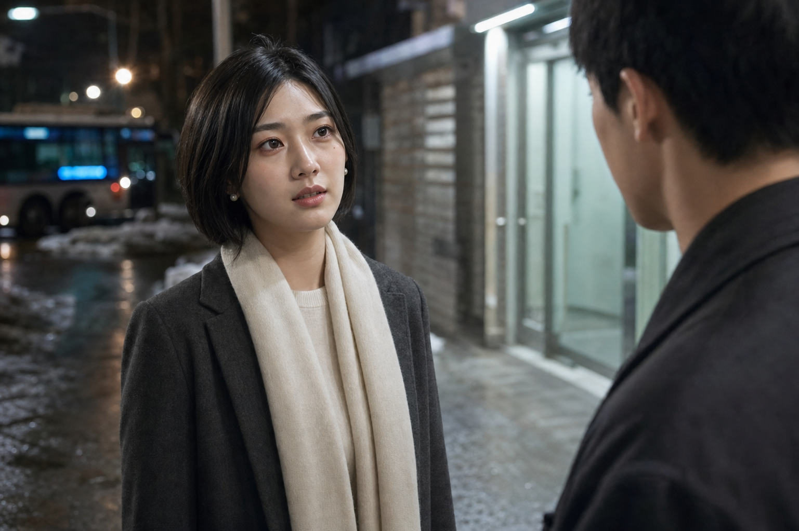

# 158. 어떤 거예요

2월 2일, 일본어 학원 앞 큰길에는 녹다 만 눈이 검은 물처럼 고여 있었다.

방학이라 학원 수강생은 적었다. 겨울 저녁의 형광등 아래에서 사람들은 말없이 계단을 오르내렸고, 자동문이 열릴 때마다 따뜻한 실내 공기와 차가운 바깥 공기가 섞였다. 용식은 수업이 끝난 뒤 일부러 조금 늦게 나왔다. 서윤이 먼저 나가 있을 거라고 생각했다.

그녀는 정말 밖에 있었다.

하지만 기다리는 얼굴은 아니었다. 학원 앞 가로등 밑에서 팔짱을 낀 채 서 있었고, 용식이 다가오자 곧장 말했다.

[한서윤] "그럼 이번엔 진짜 어떤 거예요?"

용식은 걸음을 멈췄다. 인사도 없었다. 춥냐는 말도, 밥 먹었냐는 말도 없었다. 지난번 그가 좋아한다고 말한 뒤로, 서윤은 오늘 이 질문만 준비한 사람처럼 서 있었다.

[김용식] "무슨 말이에요."

[한서윤] "모르는 척하지 마요."

서윤은 학원 출입문에서 조금 떨어진 골목 쪽으로 걸었다. 용식은 따라갔다. 둘이 자주 서 있던 자리였다. 큰길에서는 보이지만, 정류장 쪽 사람들과는 조금 떨어진 곳. 숨기려면 숨길 수 있고, 들키려면 들킬 수도 있는 애매한 거리.

[한서윤] "보고 싶다고 했잖아요."

[김용식] "네."

[한서윤] "좋다고도 했고."

[김용식] "네."

[한서윤] "그럼 그다음은요."

용식은 대답을 준비하지 못했다. 준비하지 않은 게 아니라, 준비하고 싶지 않았다. 좋아한다는 말은 감정이었다. 그다음은 관계였다. 관계가 되면 초연이 있었다. 초연과의 미뤄진 약속, 개강 전에 얼굴 보자는 문자, 아직 끝나지 않은 이름.

[김용식] "서윤 씨."

[한서윤] "또 그렇게 부르지 말고요."

[김용식] "제가 뭐라고 해야 할지."

[한서윤] "그러니까 묻잖아요. 어떤 거냐고."

서윤의 목소리는 높지 않았다. 화를 내는 것보다 더 진지했다. 그래서 더 피하기 어려웠다. 그녀는 용식의 표정을 보고 한숨을 작게 쉬었다.

[한서윤] "나한테 보고 싶다고 했으면, 그다음도 말해야죠."

[김용식] "그다음이 꼭 지금이어야 해요?"

[한서윤] "네."

단호했다.

[김용식] "왜요."

[한서윤] "내가 또 기다리면, 용식 씨는 기다리게 둘 사람이니까."

용식은 반박하지 못했다. 서윤은 그 반박 없는 얼굴을 보고 고개를 돌렸다. 큰길 쪽으로 버스가 지나가며 물웅덩이를 밟았다. 작은 물소리가 골목까지 튀었다.

[한서윤] "그 사람하고는 어떻게 됐어요."

[김용식] "얘기 중이에요."

[한서윤] "얘기 중."

[김용식] "정리하려고 해요."

[한서윤] "하려고."

서윤은 그의 단어를 하나씩 되받았다. 용식이 숨으려고 고른 말들이 그녀의 입에서 다시 나올 때마다, 그 말들은 더 초라해졌다.

[한서윤] "거의, 나중에, 하려고. 용식 씨 말은 항상 문이 반쯤 열려 있어요."

[김용식] "끝내는 게 쉬운 게 아니잖아요."

[한서윤] "그럼 나한테 좋아한다고 하는 건 쉬워요?"

그 말에 용식은 숨이 막혔다. 서윤은 눈을 피하지 않았다.

[한서윤] "좋아한다는 말이 쉬운 사람이면, 나한테 하지 말았어야죠."

용식은 손에 쥔 폴더폰을 내려다봤다. 화면은 꺼져 있었다. 그런데도 초연의 문장이 보이는 것 같았다. 개강 전에 얼굴은 보자. 진짜. 그 문자는 아직 답 하나만 받은 상태였다. 날짜도 없고, 장소도 없고, 결론도 없었다.

서윤은 폴더폰을 보더니 작게 웃었다.

[한서윤] "또 그 사람 생각해요?"

[김용식] "아니요."

[한서윤] "거짓말."

[김용식] "생각은 나죠."

[한서윤] "그럼 왜 나한테 왔어요."

질문이 다시 처음으로 돌아왔다. 어떤 거냐고. 왜 왔냐고. 용식은 차가운 공기를 들이마셨다. 피하고 싶었다. 그런데 피하면 서윤은 정말 돌아설 것 같았다. 지난번처럼 차갑게 돌아서는 게 아니라, 이번엔 자기 손으로 문을 닫을 것 같았다.

[김용식] "서윤 씨 놓치기 싫어서요."

서윤의 표정이 조금 흔들렸다.

[한서윤] "그럼 잡아요."

[김용식] "잡고 있잖아요."

[한서윤] "손 말고요."

말끝이 낮았다. 용식은 그제야 서윤의 손을 잡고 있지 않다는 걸 깨달았다. 둘은 가까이 서 있었지만 손은 떨어져 있었다. 지난번에는 손을 먼저 잡았다. 오늘은 말로 잡아야 했다.

[김용식] "초연이랑은 거의 끝났어요."

서윤의 얼굴에서 온기가 빠졌다.

[한서윤] "거의 말고요."

[김용식] "서윤 씨."

[한서윤] "끝났어요, 안 끝났어요?"

용식은 입을 열지 못했다.

그 한 박자가 모든 걸 말했다. 초연과 끝나지 않았다. 서윤도 알았다. 알면서 물었다. 확답을 듣기 위해서가 아니라, 용식이 어디까지 거짓말할 수 있는지 보기 위해서.

[한서윤] "대답 못 하네요."

[김용식] "정리할 거예요."

[한서윤] "그 말은 들었어요."

[김용식] "진짜예요."

[한서윤] "진짜면 정리하고 와요."

서윤은 돌아서려 했다. 용식은 반사적으로 그녀의 손목을 잡았다. 세게 잡지는 않았다. 하지만 놓치면 안 된다는 마음이 손끝에 먼저 나갔다. 서윤은 걸음을 멈췄다.

[한서윤] "이거 놓고 말해요."

용식은 손을 놓았다.

[김용식] "가지 마요."

[한서윤] "왜요."

[김용식] "오늘 이렇게 가면, 진짜 끝날 것 같아서요."

[한서윤] "뭐가요. 우리 뭐가 있었는데요."

그 말이 더 아팠다. 도쿄의 보름, 수원역의 밤, 학원 뒤의 손끝, 차 안의 침묵. 많은 것이 있었는데, 이름은 없었다. 이름 없는 것들은 이렇게 질문 하나에 밀려났다.

[김용식] "있었잖아요."

[한서윤] "그럼 이름 붙여요."

서윤은 울지 않았다. 눈가가 붉어졌지만, 목소리는 단단했다.

[한서윤] "나 용식 씨 힘들 때만 부르는 사람 하기 싫다고 했잖아요."

[김용식] "알아요."

[한서윤] "알면 말해요. 아니면 보내 줘요."

차가운 바람이 골목을 지나갔다. 용식은 서윤의 얼굴을 보았다. 도쿄에서 사진 밖으로 밀려나던 얼굴, 공항에서 돌아서던 얼굴, 한국에 와서 없는 사람 취급 지겹다고 하던 얼굴이 겹쳤다. 그는 서윤을 잃고 싶지 않았다. 그 마음만큼은 분명했다.

하지만 초연과 끝났다고 말할 수는 없었다.

아직은.

그는 비겁한 중간을 골랐다.

[김용식] "조금만 시간 줘요."

서윤은 눈을 감았다 떴다.

[한서윤] "또요."

[김용식] "이번엔 진짜."

[한서윤] "그 말도 싫어요."

서윤은 한 걸음 물러섰다. 용식은 잡지 못했다. 그녀는 큰길 쪽으로 걸어가다가 멈추고 돌아봤다.

[한서윤] "다음에 만나면, 대답해요."

[김용식] "서윤 씨."

[한서윤] "끝났어요, 안 끝났어요. 그거부터요."

그녀는 더 기다리지 않았다. 버스정류장 쪽으로 걸어갔다. 용식은 골목 입구에 서서 그녀의 뒷모습을 봤다. 따라가면 또 손은 잡을 수 있을 것이다. 하지만 오늘 서윤은 손을 원하는 게 아니었다.

폴더폰이 울렸다.

[김초연] 이번 주말은 안 되는 거지?

용식은 화면을 봤다. 대답해야 할 사람이 둘이었다. 한 사람은 끝났냐고 물었고, 한 사람은 안 되는 거냐고 물었다.

그는 초연에게 답했다.

[김용식] 응. 미안. 개강 전에 꼭 보자.

전송하고 나니 서윤에게 전화하고 싶어졌다. 하지만 전화해도 할 말은 하나뿐이었다.

끝났어요, 안 끝났어요.

그는 아직 그 질문에 대답하지 못했다.

집으로 돌아가는 길, 운전석 옆자리는 비어 있었다. 그 빈자리에 서윤이 앉아 있는 것처럼 느껴졌다. 그리고 뒷좌석 어딘가에는 초연의 조용한 문장이 놓여 있는 것 같았다.

두 사람 다 아무것도 훔쳐보지 않았다.

두 사람 다 정답을 알지 못했다.

그런데 용식이 도망치는 방향만은 점점 선명해지고 있었다.
