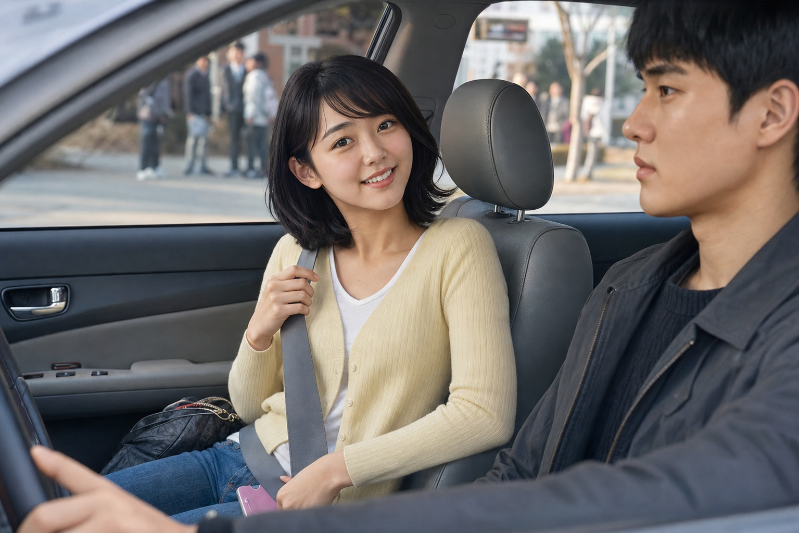

# 165. 자유롭네

개강 첫날, 소문은 출석보다 빨랐다.

3월 2일 아침, 평택대 캠퍼스는 아직 겨울 냄새가 남아 있었다. 학생회관 앞 벤치에는 녹지 않은 눈이 검게 뭉쳐 있었고, 새 학기 시간표를 확인하는 학생들이 건물 앞에서 폴더폰을 열었다 닫았다. 용식은 BMW를 주차장에 세우고 내렸다. 차 문이 닫히는 소리가 크게 울렸다.

단체방은 아침부터 떠들썩했다.

[평택대 동기] 야 진짜 용식이랑 초연이 헤어짐?

[평택대 동기] 그런 듯? 둘이 같이 안 온대.

[평택대 동기] 초연이는 요즘 수원 쪽 친구랑 자주 있다던데.

용식은 화면을 닫았다. 소문은 정확한 듯 부정확했다. 헤어진 건 맞았다. 수원 쪽 친구는 민준일 것이다. 그러나 아무도 서윤은 몰랐다. 아무도 그가 이미 다른 사람에게 여자친구라고 말하고 있다는 걸 몰랐다.

강의실 앞 복도에서 몇 명이 그를 봤다. 대놓고 묻는 사람은 없었다. 대신 눈길이 따라왔다. 새 학기 첫날의 시선은 늘 가벼운데, 오늘은 조금 더 끈적했다.

오전 강의가 끝나고 매점 앞에 섰을 때, 정다은이 나타났다.

그녀는 예전처럼 갑자기 옆으로 끼어들었다. 손에는 캔커피 두 개가 들려 있었다. 하나를 용식 쪽으로 내밀었다.

[정다은] "오랜만."

[김용식] "어."

[정다은] "반응 뭐야. 너무 반갑다?"

[김용식] "개강 첫날부터 피곤해서."

[정다은] "피곤한 얼굴은 방학 전부터였잖아."

정다은은 웃었다. 웃음은 가벼웠지만 눈은 그렇지 않았다. 그녀는 용식의 얼굴을 훑고, 손에 든 폴더폰을 보고, 다시 그의 눈을 봤다.

[정다은] "진짜 헤어졌어?"

용식은 캔커피를 받지 않았다.

[김용식] "소문 빠르네."

[정다은] "학교 좁잖아."

[김용식] "응. 헤어졌어."

말하고 나니 이상했다. 초연과 헤어진 사실을 학교에서 처음 인정했다. 서윤에게는 이미 끝났다고 거짓말했고, 초연과는 실제로 끝났다. 이제 그 말은 사실이었다. 그런데 사실인데도 편하지 않았다.

정다은은 고개를 작게 끄덕였다.

[정다은] "그럼 이제 나도 태워줘도 되는 거지?"

말투는 장난이었다. 하지만 너무 직접적이었다. 예전에는 부탁에 핑계가 있었다. 자료, USB, 조별 과제 박스, 술자리 귀가. 오늘은 핑계가 거의 없었다. 초연이라는 감시가 사라졌는지 확인하듯, 정다은은 바로 차를 말했다.

[김용식] "어딜."

[정다은] "정류장까지."

[김용식] "정류장은 걸어가도 되잖아."

[정다은] "그럼 수원까지."

[김용식] "너 수원 안 살잖아."

[정다은] "아, 들켰네."

정다은은 캔커피 하나를 자기 뺨에 댔다. 차가운 캔 때문에 그녀가 살짝 눈을 찡그렸다.

[정다은] "그냥 타 보고 싶어서."

[김용식] "내 차를?"

[정다은] "네 조수석."

용식은 주변을 봤다. 매점 앞에는 학생들이 많았다. 예전 같으면 이 자리에서 바로 거절했을 것이다. 초연이 볼 수도 있었고, 누가 말할 수도 있었다. 그런데 이제 초연과는 끝났다. 그 사실이 이상하게 안전장치가 아니라 빈자리처럼 느껴졌다.

폴더폰이 울렸다.

[한서윤] 오늘 저녁 뭐 먹을까?

용식은 문자창을 보며 손가락을 멈췄다. 서윤의 자취방 냉장고, 히터, 새 형광등이 떠올랐다. 그는 서윤에게 답했다.

[김용식] 너 먹고 싶은 거. 내가 사 갈게.

전송.

정다은이 옆에서 말했다.

[정다은] "누구야?"

[김용식] "그냥."

[정다은] "그냥이 제일 수상한데."

[김용식] "너 그런 말 할 처지는 아니지 않냐."

[정다은] "나? 나는 이제 수상해도 되는 타이밍 아니야?"

그 말이 웃음처럼 지나갔지만, 용식은 웃지 못했다. 정다은은 초연과 헤어진 사실만 알고 있었다. 서윤과 사귀는 건 몰랐다. 모르는 채로 지금을 틈이라고 읽고 있었다. 그게 오히려 위험했다. 아무도 전체를 모르는 상태에서, 용식만 두 개의 방향을 동시에 열고 있었다.

오후 수업이 끝나고, 정다은은 정말 주차장까지 따라왔다. 가방을 어깨에 걸치고, 아무 일 아니라는 듯 걸었다.

[김용식] "너 진짜 탈 거야?"

[정다은] "왜. 안 돼?"

[김용식] "갈 데도 없으면서."

[정다은] "정류장까지 태워 준다며."

[김용식] "내가 언제."

[정다은] "지금부터."

정다은은 조수석 문 앞에 섰다. 용식이 잠금 해제 버튼을 누르자, 그녀는 기다렸다는 듯 탔다. 차 안에 들어온 향이 낯설지 않았다. 10월의 밤이 짧게 떠올랐다. 학생회관 앞, 초연의 전화, 집에 가는 중이라는 거짓말, 그리고 정다은의 입술.

용식은 운전석에 앉아 시동을 걸었다.

[정다은] "오랜만이다."

[김용식] "뭐가."

[정다은] "이 자리."

[김용식] "너 그런 말 일부러 하지."

[정다은] "응."

정다은은 안전벨트를 천천히 맸다. 손끝이 벨트 버클을 누르는 소리가 작게 났다.

[정다은] "너 이제 진짜 자유롭네?"

용식은 대답하지 않았다. 대신 핸들 위치를 괜히 고쳐 잡았다. 자유. 그 단어가 차 안에서 이상하게 울렸다. 초연과 헤어졌으니 자유로워진 건 맞았다. 그런데 그는 이미 서윤에게 묶여 있었다. 아니, 묶였다기보다 기대고 있었다. 그런데도 정다은을 차에 태웠다.

자유가 아니라, 더 복잡해진 것뿐이었다.

[정다은] "왜 대답 안 해."

[김용식] "자유롭다고 다 좋은 건 아니니까."

[정다은] "그래도 숨은 쉬잖아."

그 말은 예전 정다은이 했던 말들과 닮아 있었다. 검사받는 사람 같다. 아직도 끌려다니냐. 정다은은 늘 용식이 숨 막히는 순간을 알아봤다. 서윤은 숨 쉴 곳이 되기 싫다고 했고, 정다은은 숨이 트이는 순간을 노렸다. 둘은 서로를 몰랐지만, 용식 안에서는 이상하게 나란히 서기 시작했다.

정류장은 금방이었다. 그런데 정다은은 바로 내리지 않았다.

[정다은] "저녁 약속 있어?"

[김용식] "있어."

[정다은] "누구?"

[김용식] "그냥."

[정다은] "또 그냥."

그녀는 고개를 돌려 용식을 봤다.

[정다은] "너 헤어졌다고 갑자기 착해진 건 아니네."

[김용식] "착한 척한 적 없어."

[정다은] "있었지. 초연 앞에서."

용식은 입을 다물었다.

정다은은 문을 열었다가 다시 닫았다. 장난처럼, 그러나 일부러 시간을 끌었다.

[정다은] "내일도 태워 줘."

[김용식] "왜."

[정다은] "그냥."

이번엔 그녀가 그 단어를 썼다. 용식은 뭐라 하지 못했다.

정다은은 차에서 내렸다. 문을 닫기 전, 고개를 숙여 말했다.

[정다은] "자유로운 김용식 씨, 내일 봐."

문이 닫혔다.

용식은 한동안 그 자리에 서 있었다. 폴더폰이 울렸다.

[한서윤] 그럼 김치찌개 먹자. 집에서 먹을래?

용식은 답장을 보냈다.

[김용식] 응. 내가 사 갈게.

전송하고 나서도 그는 정다은이 앉았던 조수석을 봤다. 아무 흔적도 없었다. 향도 금방 사라질 것이다. 그런데 사라질수록 더 위험한 것들이 있었다.

차 안에는 두 얼굴이 남았다.

서윤에게 보내는 다정한 문자.

정다은을 태운 조수석.

용식은 아직 그 둘이 같은 날 벌어진 일이라는 걸 제대로 자각하지 못했다.
