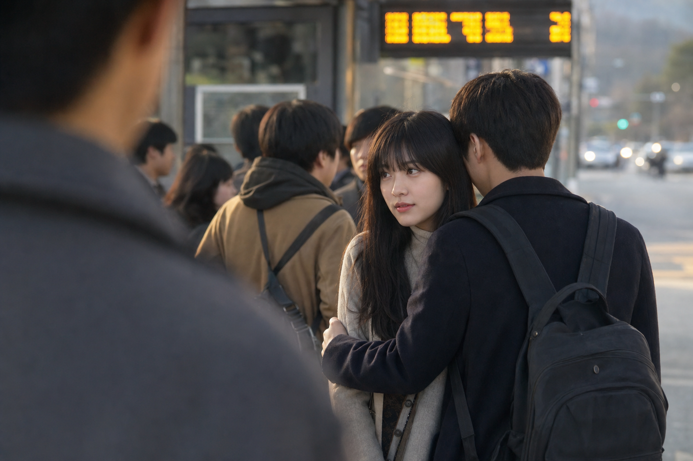

# 167. 정류장

3월 6일 금요일 저녁, 캠퍼스 인근 정류장은 사람들로 붐볐다.

금요일 수업이 끝난 뒤라 버스를 기다리는 학생들이 길게 서 있었다. 누군가는 동아리 모임 얘기를 했고, 누군가는 신입생 환영회 장소를 물었다. 용식은 주차장으로 가려다 발걸음을 늦췄다. 정다은에게서 전화가 오기로 되어 있었다. 어제 문자로 데려다 달라고 했고, 오늘도 수업 끝나면 연락하겠다고 했다.

그는 폴더폰을 확인했다.

새 전화는 없었다.

대신 멀리 정류장 끝에서 낯익은 뒷모습이 보였다. 초연이었다.

처음엔 그냥 지나가려 했다. 정말 그럴 생각이었다. 둘은 헤어졌다. 이제 초연이 누구와 있든, 어디서 버스를 기다리든, 용식이 끼어들 자리는 없었다. 그렇게 생각하면서도 발은 멈췄다.

초연 옆에는 민준이 있었다.

민준은 초연보다 조금 앞에 서 있다가, 버스가 하나 지나가자 뒤로 물러섰다. 초연이 뭐라고 말했고, 민준이 고개를 숙여 들었다. 두 사람은 웃지 않았다. 오히려 조용했다. 그래서 더 가까워 보였다.

용식은 가로등 뒤에 섰다. 숨으려고 한 건 아니었다. 그렇다고 당당히 지나갈 수도 없었다. 그는 자신이 무엇을 하는지 알면서도 움직이지 않았다.

민준이 초연의 손목을 아주 조심스럽게 잡았다.

초연은 빼지 않았다.

그 짧은 장면 하나에 용식의 속이 내려앉았다. 손목 하나. 그게 뭐라고. 자신은 서윤의 자취방에 드나들고, 서윤에게 여자친구라고 말하고, 정다은을 차에 태웠다. 어제도 정다은에게 수업 끝나고 보자고 답했다. 그런데 초연이 민준의 손을 빼지 않는 것만으로도 속이 뒤틀렸다.

민준이 무언가 말했다. 초연은 고개를 숙였다. 다음 순간, 민준이 초연을 안았다.

오래.

정류장에 사람이 많았지만, 두 사람 주변만 조용해 보였다. 민준은 세게 끌어안지 않았다. 조심스럽게, 그러나 분명하게. 초연은 처음엔 굳어 있다가 천천히 팔을 올렸다. 민준의 등 쪽으로 손이 갔다. 포옹이 완성됐다.

용식은 숨을 제대로 쉬지 못했다.

그 장면은 어떤 물증보다 직접적이었다. 그렇다고 초연이 잘못한 것도 아니었다. 헤어졌다. 공식적으로 끝났다. 초연은 나고야도, 유즈키도, 서윤과의 도쿄도, 정다은과의 차 안 키스도 모른 채로 끝을 받아들였다. 그리고 이제 자기 옆을 지켜 준 사람에게 기대고 있었다.

그런데 용식의 머릿속에서는 다른 문장이 먼저 떠올랐다.

그렇게 나를 들들 볶더니.

나한테는 그렇게 엄격하게 굴더니.

결국 너도 똑같잖아.

생각이 너무 빠르게 왔다. 오기 전에 부끄러움이 막아야 했는데, 부끄러움은 늦었다. 분노와 상실감이 먼저였다. 그는 자기 잘못을 순간적으로 지웠다. 서윤도 지웠고, 정다은도 지웠고, 유즈키도 지웠다. 남은 것은 정류장에서 다른 남자 품에 안긴 초연뿐이었다.

용식은 한 걸음 뒤로 물러섰다.

그러다 발끝이 보도블록 턱에 걸렸다. 작게 소리가 났다. 초연이 고개를 돌릴 뻔했다. 용식은 바로 몸을 틀었다. 보였는지 아닌지 알 수 없었다. 알고 싶지도 않았다.

그는 주차장 쪽으로 걸었다. 걸음이 빨라졌다. 누구에게 들킨 것도 아닌데, 마치 자신이 들킨 사람처럼 심장이 뛰었다.

차에 도착해서 문을 열고 앉았다. 운전석은 차가웠다. 그는 시동을 걸지 않은 채 핸들만 잡았다. 손에 힘이 들어갔다.

폴더폰이 울렸다.

정다은.

용식은 화면을 보다가 받았다.

[김용식] "어."

[정다은] "어디야?"

[김용식] "주차장."

[정다은] "나 정문 쪽인데. 데리러 올 거야?"

용식은 정류장 쪽을 떠올렸다. 초연과 민준. 포옹. 초연이 민준의 등을 잡던 손.

[김용식] "가."

[정다은] "오, 대답 빠르네."

[김용식] "기다려."

[정다은] "무슨 일 있어?"

정다은의 목소리는 가볍다가도 순간적으로 날카로워졌다. 그녀는 이런 식으로 용식의 빈틈을 읽었다. 하지만 그녀는 정류장에서 무엇을 봤는지 모른다. 서윤도 모른다. 아무도 전체를 모른다.

[김용식] "아니. 그냥."

[정다은] "그냥이면 더 궁금한데."

[김용식] "타서 얘기해."

전화를 끊고 나서, 용식은 서윤의 문자창을 열었다. 아까 도착해 있던 문자가 있었다.

[한서윤] 오늘도 우리 집 올 거지?

우리 집.

서윤은 이제 자취방을 그렇게 말하기 시작했다. 우리 집. 둘이 같이 채운 냉장고, 작은 히터, 새 형광등. 용식은 그 문장을 보고 답장을 썼다.

[김용식] 응. 조금 늦을게.

전송.

그리고 바로 차를 움직였다. 정다은이 기다리는 정문 쪽으로.

차가 정류장 앞을 지날 때, 용식은 보지 않으려고 했다. 그런데 눈은 마음보다 늦었다. 유리창 너머로 초연과 민준이 다시 보였다. 이제 포옹은 풀려 있었다. 민준은 초연의 가방을 대신 들고 있었고, 초연은 버스 도착 안내판을 보고 있었다. 둘은 너무 자연스러웠다.

그 자연스러움이 더 싫었다.

정문 앞에서 정다은이 차를 발견하고 손을 들었다. 그녀는 조수석 문을 열고 탔다. 익숙한 듯 안전벨트를 맸다.

[정다은] "표정 왜 그래."

[김용식] "피곤해서."

[정다은] "거짓말."

[김용식] "너는 왜 맨날 거짓말이라고 하냐."

[정다은] "진짜일 때가 별로 없으니까."

정다은은 창밖을 보다가 다시 용식을 봤다.

[정다은] "초연 봤어?"

용식의 손이 굳었다.

[김용식] "왜."

[정다은] "아까 정류장 쪽에 있던데. 민준인가 뭔가 하는 애랑."

정다은은 민준의 이름 정도는 소문으로 알고 있었다. 그 이상은 몰랐다. 말투는 가볍지만, 용식의 반응을 보려는 말이었다.

[김용식] "봤으면 뭐."

[정다은] "아니. 헤어졌다며."

[김용식] "헤어졌지."

[정다은] "근데 왜 그렇게 굳어."

용식은 대답하지 않았다. 차는 천천히 학교 앞 도로를 빠져나갔다. 저녁 하늘은 어두워지고 있었고, 신호등 빨간빛이 보닛 위에 번졌다.

[정다은] "너 진짜 웃긴다."

[김용식] "뭐가."

[정다은] "네가 먼저 놓은 얼굴인데, 누가 주워 가면 싫은 얼굴."

용식은 브레이크를 조금 세게 밟았다. 차가 살짝 앞으로 쏠렸다.

[정다은] "아, 미안."

[김용식] "말 조심해."

[정다은] "왜. 찔려?"

정다은은 겁먹지 않았다. 오히려 조용히 웃었다. 용식은 그 웃음이 싫으면서도, 이상하게 그 날카로움에 기대고 싶었다. 서윤은 믿어 주었다. 정다은은 찔렀다. 믿음과 찌름 사이에서, 용식은 둘 다 놓지 못하고 있었다.

폴더폰이 다시 울렸다.

서윤이었다.

[한서윤] 밥은 먹고 와. 아니면 내가 해둘게.

용식은 신호 대기 중 답장을 보냈다.

[김용식] 해두지 마. 내가 사 갈게.

정다은이 옆에서 말했다.

[정다은] "누구한테 그렇게 다정해?"

[김용식] "신경 꺼."

[정다은] "싫은데."

용식은 대답하지 않았다.

차 안에는 정다은이 있었고, 폴더폰 안에는 서윤이 있었고, 방금 지나온 정류장에는 초연이 있었다. 모두 다른 방향인데, 이상하게 한 줄로 이어졌다.

그날 밤은 아직 끝나지 않았다.

하지만 용식은 이미 다음 문제 안으로 들어가고 있었다.
