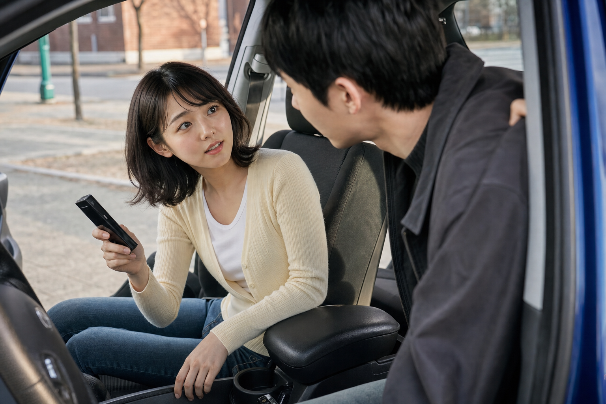

# 172. 낯선 케이스

3월 17일 화요일 오후, 정다은의 손이 무심코 용식의 다른 폰을 만졌다.

차 안이었다. 학교 후문 근처 골목에 잠깐 세워 둔 파란색 7시리즈 안에는 햇빛이 비스듬히 들어왔다. 정다은은 조수석에 앉아 가방을 뒤적이다가, 컵홀더 옆에 놓인 검은색 폰을 집어 들었다. 용식은 운전석 문을 닫고 들어오던 중이었다.

[정다은] "어?"

짧은 소리였는데, 용식의 등줄기가 바로 굳었다.

[김용식] "왜."

[정다은] "이거 케이스 바꿨어?"

다은이 들고 있는 건 검은색 폰이었다. 평택폰. 다은에게 번호 바꿨다고 준 그 폰. 그런데 문제는 그녀가 묻는 방식이었다. 그녀가 본 건 폰 하나뿐이지만, `바꿨어?`라는 말 안에는 이전의 은색 폰 이미지가 있었다. 캠퍼스에서, 차 안에서, 매점 앞에서 몇 번 봤던 익숙한 물건.

용식은 손을 뻗어 자연스럽게 받아 들었다.

[김용식] "응. 새로 산 거잖아."

[정다은] "아 맞다. 번호 바꿨다 했지."

정다은은 고개를 끄덕였다. 너무 쉽게 넘어간 것 같았다. 하지만 그녀의 눈은 폰에서 완전히 떨어지지 않았다. 확정 정보는 없었다. 그냥 낯선 케이스, 낯선 무게, 그리고 용식이 받아 드는 속도만 있었다.

[정다은] "근데 너 방금 되게 빨랐다."

[김용식] "뭐가."

[정다은] "내 손에서 빼앗는 거."

[김용식] "떨어뜨릴까 봐."

[정다은] "나 손 그렇게 헐렁하지 않은데."

정다은은 웃었다. 장난처럼 던졌지만, 웃음 뒤에 작은 걸림이 있었다. 용식은 시동을 걸었다. 엔진음이 낮게 울리자 차 안의 정적이 조금 밀려났다.

이번 주 들어 이중 생활은 이상할 만큼 잘 굴러갔다. 낮에는 캠퍼스에서 다은과 밥을 먹고, 쉬는 시간에는 후문 쪽 골목으로 빠져 짧게 드라이브했다. 밤에는 수원으로 가서 서윤의 자취방에 들렀다. 장을 보고, 쓰레기를 버려 주고, 고장 난 싱크대 배수구를 만져 보고, 침대 옆에 앉아 그녀의 하루를 들었다.

서윤은 아직 아무것도 몰랐다.

다은도 아직 아무것도 몰랐다.

둘 다 이름 정도의 그림자만 가진 채, 서로의 실제 시간을 모른 채, 각자의 자리에서 용식을 남자친구라고 믿고 있었다.

그 믿음 사이를 오가며 용식은 점점 능숙해졌다. 검은색 폰은 학교와 차 안에서만 열었다. 은색 폰은 수원과 밤에만 열었다. 정다은에게는 집안일, 과제, 차 정비를 핑계로 시간을 끊었고, 서윤에게는 개강 초라 피곤하다는 말로 늦음을 덮었다.

문제는 능숙해질수록 긴장이 줄어든다는 것이었다.

그날 점심 학생식당에서 남자 동기 하나가 용식의 새 차 얘기를 또 꺼냈다. 이름도 얼굴도 늘 배경처럼 지나가던 동기였지만, 오늘은 목소리가 조금 컸다.

[동기1] "차만 보면 거의 사장님이네. 학교 왜 다니냐."

[동기2] "여자친구 갈아타면 차도 갈아타는 거지 뭐."

웃음이 몇 명 사이에서 번졌다. 정다은은 숟가락을 내려놓고 그쪽을 봤다. 용식은 먼저 반응하지 않으려 했다. 하지만 `갈아타면`이라는 말이 귀에 박혔다. 자신이 한 일을 누군가 정확히 모르는 채 가장 비슷한 단어로 건드린 셈이었다.

[정다은] "너네 밥이나 먹어."

정다은이 먼저 말했다. 목소리는 크지 않았지만 충분히 들렸다. 동기들이 잠깐 조용해졌다가, 헛웃음을 흘리며 고개를 돌렸다. 용식은 다은을 봤다. 그녀는 아무렇지 않은 척 국을 떠먹었다.

[김용식] "굳이 왜 그래."

[정다은] "내 남자친구 씹는데 내가 가만히 있어?"

그 말이 용식의 자존심을 건드렸다. 이상하게 좋았다. 다은이 공개적으로 자신을 편드는 장면. 초연과 헤어진 뒤, 자신에게 아직 선택받을 힘이 있다는 걸 보여 주는 장면. 서윤의 방 안 안정과는 전혀 다른 종류의 인정이었다.

용식은 웃음을 참지 못했다.

[정다은] "왜 웃어."

[김용식] "좋아서."

[정다은] "뭐가."

[김용식] "네가 내 편 드는 거."

정다은은 숟가락을 든 채 멈췄다. 그러다 시선을 피했다.

[정다은] "그런 말 갑자기 하지 마."

그날 오후, 캠퍼스에는 또 다른 소문이 돌았다. 초연이 민준과 같이 있었다는 말이었다. 누가 봤는지, 어디서 봤는지는 매번 달랐다. 학생회관 앞이었다는 말도 있고, 정류장이었다는 말도 있고, 패션디자인과 작업실 근처였다는 말도 있었다.

구체적인 것은 없었다.

그래서 더 오래 돌았다.

용식은 그 말을 들을 때마다 모르는 척했다. 이미 봤다. 정류장에서 포옹하는 것을 직접 봤다. 초연은 이제 자기 생활을 하고 있을 뿐이었다. 그런데도 그 이름이 들리면 속이 아주 조금씩 긁혔다.

정다은은 그 표정을 다시 봤다.

[정다은] "또 신경 쓰여?"

[김용식] "아니."

[정다은] "너 거짓말할 때 턱에 힘 들어가."

[김용식] "그런 거까지 보냐."

[정다은] "응. 나 남자친구 생겼으니까 좀 봐야지."

용식은 그 말에 웃었다. 다은은 모른다. 자신이 보는 턱의 힘이 초연 때문만이 아니라, 밤마다 서윤에게 가는 동선과 검은색 폰 때문이라는 걸 모른다. 그래도 그녀는 자신이 볼 수 있는 만큼 정확했다.

저녁에는 서윤의 자취방으로 갔다. 가는 길에 용식은 일부러 더 좋은 딸기 한 팩과 작은 케이크를 샀다. 기념일도 아니었다. 서윤이 뭘 먹고 싶다고 한 것도 아니었다. 그냥 사야 할 것 같았다.

낮에 다은이 내 편이라고 말해 준 만큼, 밤에는 서윤에게 더 잘해야 했다. 죄책감은 늘 선물과 손길로 길을 찾았다.

서윤은 케이크를 보고 웃었다.

[한서윤] "오늘 무슨 날이야?"

[김용식] "아니. 그냥 네 생각나서."

[한서윤] "너 이러면 나 진짜 기대한다."

[김용식] "기대해."

말은 쉽게 나왔다. 서윤은 그 말을 믿었다. 방 안 조명 아래에서 그녀의 얼굴이 부드러워졌다. 용식은 케이크를 냉장고에 넣고, 딸기를 씻고, 그녀가 좋아하는 컵을 꺼냈다. 낮에 다은이 자신을 공개적으로 편든 장면이 아직 기분 좋게 남아 있었고, 그 기분 좋은 죄가 밤의 다정함을 더 과하게 만들었다.

서윤이 딸기를 하나 집어 그의 입가에 가져왔다.

[한서윤] "먹어."

용식은 받아먹었다. 손끝에 물기가 묻어 있었고, 딸기 향이 가까웠다. 그는 서윤의 손목을 잡고 살짝 끌어당겼다. 서윤은 놀란 듯 웃다가, 그의 무릎 옆에 앉았다.

[한서윤] "너 요즘 스킨십 많아진 거 알아?"

용식은 대답하지 않았다. 대신 그녀의 손등을 감싸 쥐었다. 서윤은 더 묻지 않았다. 확실한 질문으로 만들지 않은 채, 그 다정함을 자기 몫으로 받아들였다.

밤이 깊어지자 방 안에는 컴퓨터 팬 소리가 낮게 돌았다. 화면은 절전 모드로 어두워져 있었고, 책상 밑 본체의 작은 불빛만 깜박였다. 서윤은 그 소리를 배경처럼 들으며 용식의 어깨에 기대었다.

[한서윤] "이 소리 이제 익숙해졌어."

[김용식] "시끄러우면 끌까?"

[한서윤] "아니. 그냥 너 있는 소리 같아서."

용식은 그 말에 잠깐 움직이지 못했다.

자신이 있는 소리.

실제로는 자신이 숨긴 다른 세계까지 계속 돌아가는 소리였다. 꺼지지 않는 본체, 꺼 둔다고 믿는 검은색 폰, 늦게 답장해도 기다리는 사람들. 그는 서윤의 머리를 쓰다듬었다. 평소보다 오래, 조심스럽게.

그 다정함이 거짓인지 진짜인지 그는 이제 구분하지 못했다.

다음 날 오후, 다시 캠퍼스였다.

정다은은 차에 타자마자 가방을 뒷좌석에 던지고 조수석을 뒤로 조금 젖혔다. 봄 햇살이 차 안으로 들어왔다. 그녀는 컵홀더에 놓인 검은색 폰을 다시 봤다. 이번에는 만지지 않았다. 그냥 보았다.

[정다은] "너 원래 은색 아니었나?"

용식의 손이 핸들 위에서 멈췄다.

[김용식] "바꿨다니까."

[정다은] "아, 그렇지."

정다은은 창밖을 봤다. 말은 끝난 것 같았다.

그런데 잠깐 뒤, 그녀가 다시 물었다.

[정다은] "근데 전에 쓰던 건 버렸어?"

용식은 바로 대답하지 못했다.

검은색 폰이 컵홀더 안에서 조용히 놓여 있었다.

그 침묵이 다음 문제였다.

### 삽화 후보

- 차 안에서 정다은이 검은색 폴더폰을 집어 들고, 용식이 문을 닫다 굳는 장면. 낯선 케이스와 손의 속도를 강조.
- 학생식당에서 정다은이 동기들의 뒷담화를 막아서는 장면. 캠퍼스 소문과 공개 연애감의 시작.
- 서윤 자취방에서 딸기와 케이크를 사이에 두고 서윤이 용식에게 기대는 장면. 컴퓨터 팬 불빛은 배경으로 작게.
